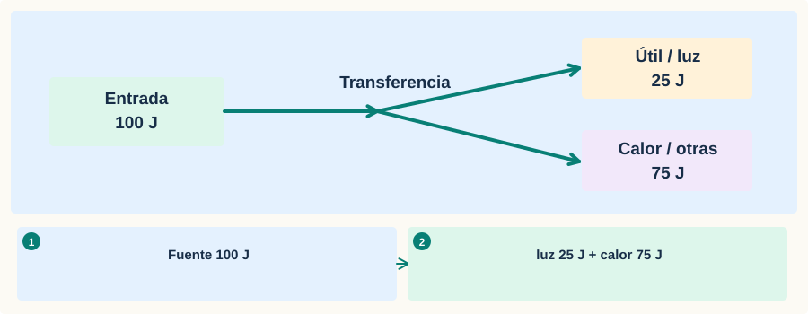

[← Anterior](03.md) · [Índice](../README.md) · [Siguiente →](05.md)

# 04 · Ley de conservación: sistema y entorno

*Diagrama didáctico y secuencia conceptual; no a escala.*

## ¿Qué es y por qué ocurre?

La energía total de un sistema aislado permanece constante. En un sistema que intercambia energía, ΔE=Eentrante−Esaliente. Hay que definir la frontera: si una batería y una lámpara están dentro, la energía química disminuye y aumenta o sale energía térmica y luminosa. El calor no es energía destruida, sino una vía de transferencia por diferencia de temperatura.

## Ejemplo explicado

> Una fuente entrega 100 J; salen 25 J como luz y 75 J como calor en un modelo ideal sin almacenamiento. Balance: 100=25+75.

## Ahora tú

Llegan 60 J, salen 15 J de luz y 35 J de calor. ¿Cuánto aumenta la energía almacenada?

[← Anterior](03.md) · [Índice](../README.md) · [Siguiente →](05.md)
