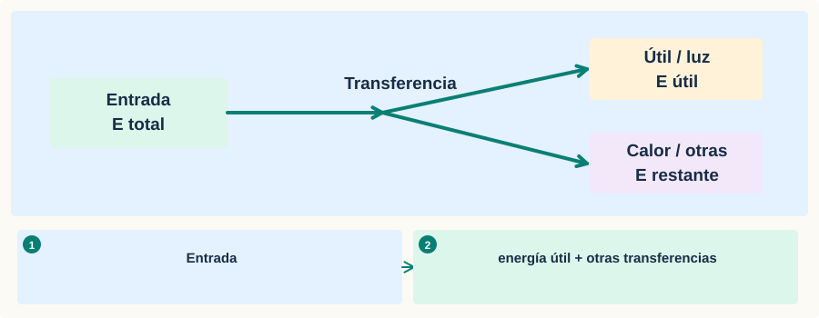

[← Anterior](04.md) · [Índice](../README.md) · [Siguiente →](06.md)

# 05 · Eficiencia y transformación

*Diagrama didáctico y secuencia conceptual; no a escala.*

## ¿Qué es y por qué ocurre?

La eficiencia se define como energía útil dividida por energía de entrada, multiplicada por 100%. Qué es útil depende del objetivo: el calor es útil en una calefacción, pero normalmente no en un LED. Una eficiencia menor que 100% no viola la conservación.

## Ejemplo explicado

> Un dispositivo recibe 200 J y entrega 80 J útiles: η=40%; 120 J se transfieren a otras formas o al entorno.

## Ahora tú

Si un motor recibe 500 J y entrega 350 J mecánicos, calcula η.

[← Anterior](04.md) · [Índice](../README.md) · [Siguiente →](06.md)
