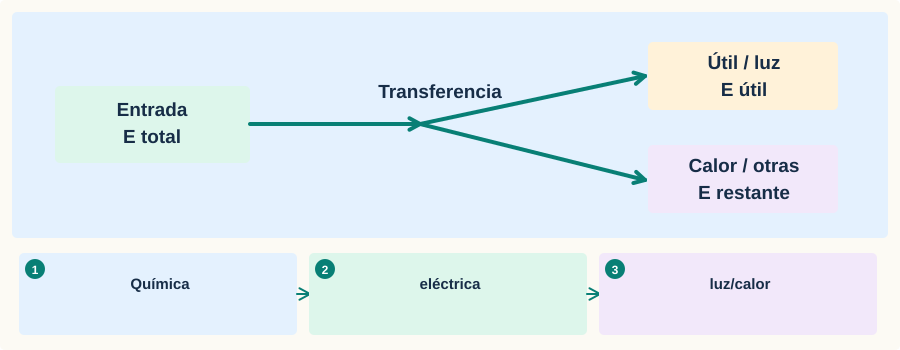

[← Anterior](05.md) · [Índice](../README.md) · [Actividades y cierre →](../descargas.md)

# 06 · De la pila al computador

*Diagrama didáctico y secuencia conceptual; no a escala.*

## ¿Qué es y por qué ocurre?

La reacción química de una batería sostiene una diferencia de potencial. Al cerrar un circuito, el campo electromagnético permite transferir energía a los componentes; la carga se conserva. Un procesador convierte energía eléctrica principalmente en calor y en operaciones físicas de conmutación; la información no es una forma de energía que sustituya el balance.

## Ejemplo explicado

> Un circuito recibe 12 J y libera 10 J al entorno; 2 J quedan almacenados temporalmente.

## Ahora tú

¿Por qué apagar un equipo no significa destruir su energía?

[← Anterior](05.md) · [Índice](../README.md) · [Actividades y cierre →](../descargas.md)
