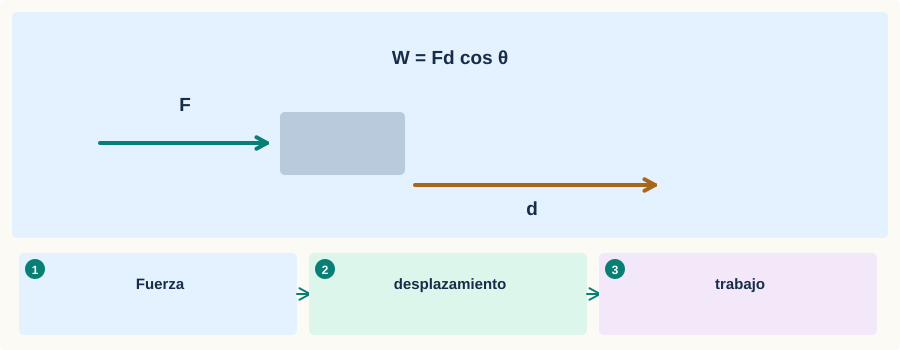

# Práctica guiada · Energía, trabajo y conservación de la energía

**Objetivo:** ¿De dónde sale la energía de una lámpara y adónde va?

## Procedimiento

Dibuja una frontera alrededor de pila y lámpara. Usa fichas de energía de 10 J para representar entrada de 100 J, luz de 30 J y calor de 70 J. Repite con 20 J almacenados. No energices un montaje.

1. Formula hipótesis y dibuja el modelo antes de intervenir.
2. Identifica magnitudes que cambian y las que permanecen fijas.
3. Realiza solo el procedimiento seguro descrito; registra resultados y unidades.
4. Compara con predicción; explica diferencias, incertidumbre y limitaciones.

| Ensayo | Condiciones | Predicción | Observación o cálculo | Explicación |
|---|---|---|---|---|
| 1 | | | | |
| 2 | | | | |
| 3 | | | | |

Rúbrica: predicción 25, registro 25, explicación 40, presentación 10. Seguridad obligatoria. En simulación, los resultados calculados no son evidencia experimental independiente.

[Simulador complementario PhET](https://phet.colorado.edu/es/simulations/energy-skate-park) · [Plantilla de informe](../../../../../plantillas/informe-laboratorio.pdf) · [PDF](003-laboratorio.pdf) · [← Índice](../README.md)
