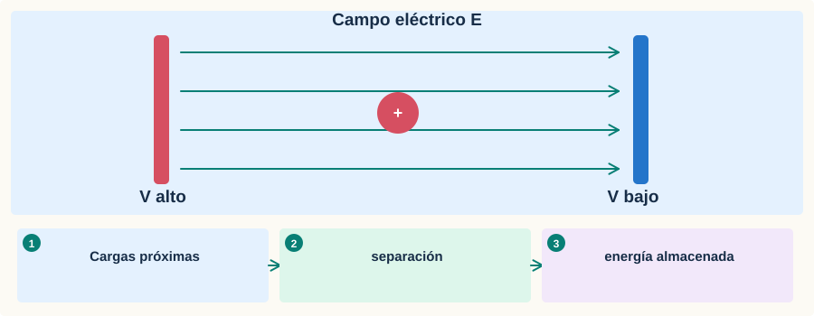
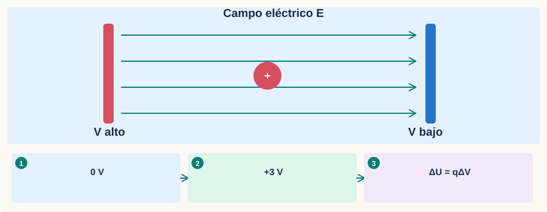
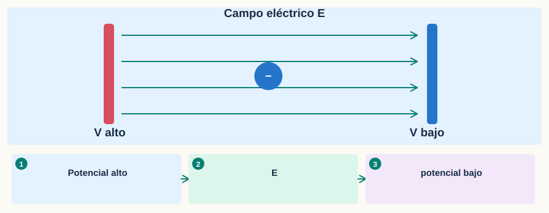
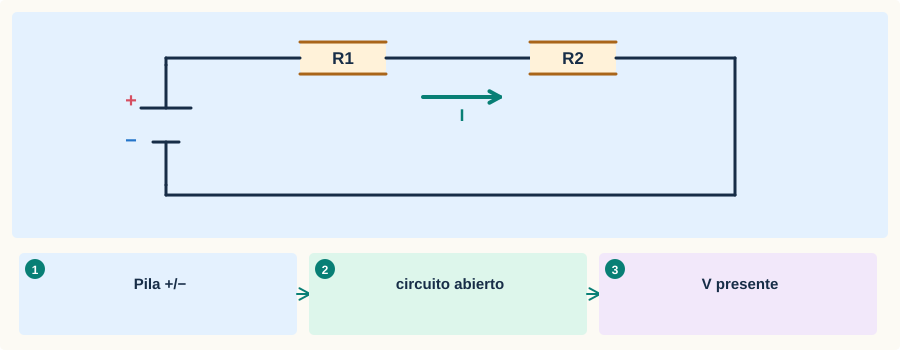
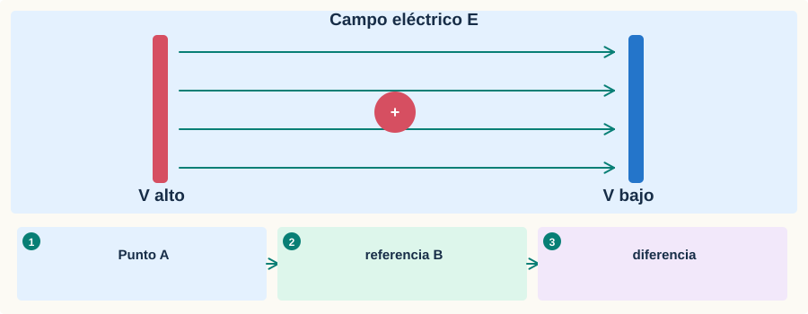
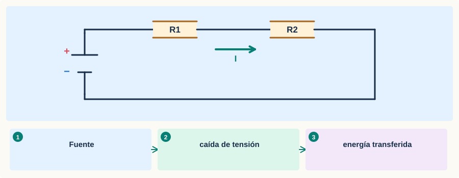

# Cuaderno de ejercicios · Clase 004

[PDF](004-ejercicios.pdf) · [← Índice](../README.md)

## 1. Energía potencial eléctrica

**Ejemplo de estudio:** Cargas opuestas tienen U negativa respecto al infinito; alejarlas requiere trabajo externo en condiciones cuasiestáticas.

**Resuelve:** ¿Separar cargas opuestas aumenta o disminuye U?

Escribe datos, procedimiento, unidades (si corresponde), dibujo y justificación. No consultes la solución antes.

## 2. Potencial y diferencia de potencial

**Ejemplo de estudio:** Mover +2 C desde 0 V hasta 3 V cambia U en +6 J. Para −2 C, ΔU=−6 J.

**Resuelve:** Una carga +3 C pasa de 2 V a 7 V. Calcula ΔU.

Escribe datos, procedimiento, unidades (si corresponde), dibujo y justificación. No consultes la solución antes.

## 3. Trabajo del campo y polaridad

**Ejemplo de estudio:** +1 µC cae de 6 V a 2 V: ΔU=−4 µJ; el campo hace +4 µJ de trabajo.

**Resuelve:** −2 µC va de 0 V a 5 V. Calcula ΔU y Wcampo.

Escribe datos, procedimiento, unidades (si corresponde), dibujo y justificación. No consultes la solución antes.

## 4. Pila desconectada: voltaje sin corriente

**Ejemplo de estudio:** Una pila de 6 V que transfiere 2 C entrega 12 J en el modelo ideal.

**Resuelve:** ¿Qué significa 9 V en J/C? ¿Es lo mismo que 9 A?

Escribe datos, procedimiento, unidades (si corresponde), dibujo y justificación. No consultes la solución antes.

## 5. Voltaje entre dos puntos

**Ejemplo de estudio:** En una placa electrónica, GND se toma como referencia 0 V; un pin a 3,3 V tiene 3,3 V respecto a GND.

**Resuelve:** VA=−2 V, VB=4 V. ¿VAB?

Escribe datos, procedimiento, unidades (si corresponde), dibujo y justificación. No consultes la solución antes.

## 6. Puente a los circuitos

**Ejemplo de estudio:** Con 3 C que atraviesan una caída de 4 V, se transfieren 12 J al elemento si no hay otros procesos.

**Resuelve:** ¿Qué energía transfiere una caída de 2 V al pasar 5 C?

Escribe datos, procedimiento, unidades (si corresponde), dibujo y justificación. No consultes la solución antes.
