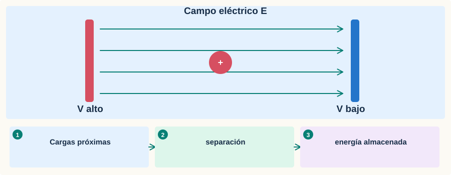
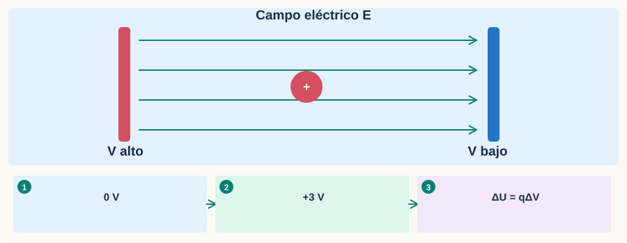
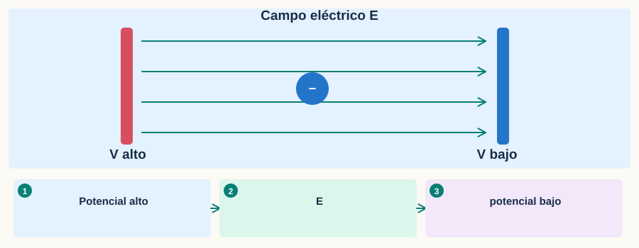
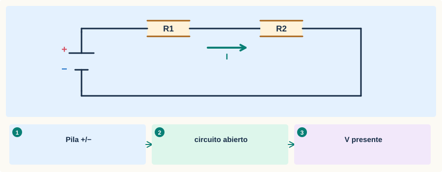
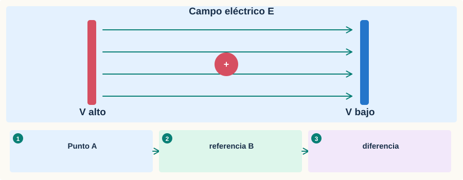
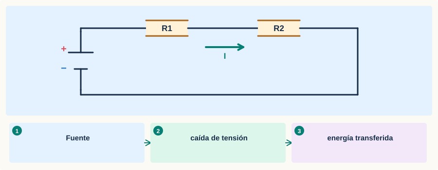

# Energía potencial eléctrica y voltaje

[← Índice](../README.md)

## 01 · Energía potencial eléctrica

Dos cargas que interactúan tienen energía potencial eléctrica asociada a su configuración. Una fuerza externa puede separar cargas que se atraen, aumentando U; el campo puede devolver esa energía como movimiento. Para dos cargas puntuales U=kqQ/r si U=0 en el infinito. El signo depende de qQ.

**Ejemplo:** Cargas opuestas tienen U negativa respecto al infinito; alejarlas requiere trabajo externo en condiciones cuasiestáticas.

**Aplica:** ¿Separar cargas opuestas aumenta o disminuye U?

---

## 02 · Potencial y diferencia de potencial

El potencial V=U/q para una carga de prueba en un campo dado se mide en J/C. La diferencia ΔV=Vf−Vi es energía potencial por unidad de carga: ΔU=qΔV. El potencial se refiere a una referencia elegida; solo las diferencias importan en los circuitos básicos.

**Ejemplo:** Mover +2 C desde 0 V hasta 3 V cambia U en +6 J. Para −2 C, ΔU=−6 J.

**Aplica:** Una carga +3 C pasa de 2 V a 7 V. Calcula ΔU.

---

## 03 · Trabajo del campo y polaridad

En electrostática, Wcampo=−ΔU. Una carga positiva libre tiende a acelerar hacia menor potencial; una negativa hacia mayor potencial, si solo actúa el campo eléctrico. La dirección de E es de potencial decreciente; para placas ideales, |E|=|ΔV|/d.

**Ejemplo:** +1 µC cae de 6 V a 2 V: ΔU=−4 µJ; el campo hace +4 µJ de trabajo.

**Aplica:** −2 µC va de 0 V a 5 V. Calcula ΔU y Wcampo.

---

## 04 · Pila desconectada: voltaje sin corriente

Procesos químicos separan carga y mantienen una diferencia de potencial entre bornes. Una pila de 1,5 V ideal puede transferir 1,5 J por cada culombio que circula en el circuito externo. Si el circuito está abierto no hay corriente sostenida, pero la tensión entre terminales puede existir.

**Ejemplo:** Una pila de 6 V que transfiere 2 C entrega 12 J en el modelo ideal.

**Aplica:** ¿Qué significa 9 V en J/C? ¿Es lo mismo que 9 A?

---

## 05 · Voltaje entre dos puntos

El voltímetro compara potenciales: VAB=VA−VB. Si A=5 V y B=2 V, VAB=3 V; VBA=−3 V. El signo depende de qué punto se usa como referencia. Una tensión no es una cantidad de electrones ni mide la rapidez de flujo.

**Ejemplo:** En una placa electrónica, GND se toma como referencia 0 V; un pin a 3,3 V tiene 3,3 V respecto a GND.

**Aplica:** VA=−2 V, VB=4 V. ¿VAB?

---

## 06 · Puente a los circuitos

El voltaje permite calcular energía transferida por carga. En una resistencia con corriente convencional del potencial alto al bajo, la energía potencial de las cargas disminuye y se transfiere al material. En la fuente, otros procesos la reponen. No se consumen electrones.

**Ejemplo:** Con 3 C que atraviesan una caída de 4 V, se transfieren 12 J al elemento si no hay otros procesos.

**Aplica:** ¿Qué energía transfiere una caída de 2 V al pasar 5 C?

---
