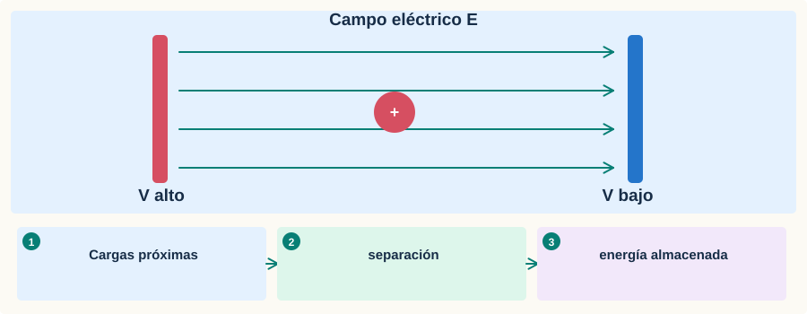

[← Portada](../README.md) · [Índice](../README.md) · [Siguiente →](02.md)

# 01 · Energía potencial eléctrica

*Diagrama didáctico y secuencia conceptual; no a escala.*

## ¿Qué es y por qué ocurre?

Dos cargas que interactúan tienen energía potencial eléctrica asociada a su configuración. Una fuerza externa puede separar cargas que se atraen, aumentando U; el campo puede devolver esa energía como movimiento. Para dos cargas puntuales U=kqQ/r si U=0 en el infinito. El signo depende de qQ.

## Ejemplo explicado

> Cargas opuestas tienen U negativa respecto al infinito; alejarlas requiere trabajo externo en condiciones cuasiestáticas.

## Ahora tú

¿Separar cargas opuestas aumenta o disminuye U?

[← Portada](../README.md) · [Índice](../README.md) · [Siguiente →](02.md)
