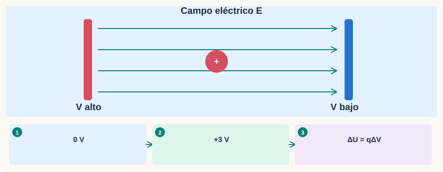
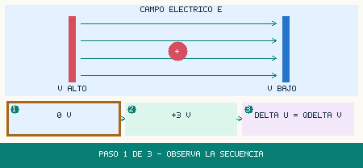

[← Anterior](01.md) · [Índice](../README.md) · [Siguiente →](03.md)

# 02 · Potencial y diferencia de potencial

*Diagrama didáctico y secuencia conceptual; no a escala.*

## ¿Qué es y por qué ocurre?

El potencial V=U/q para una carga de prueba en un campo dado se mide en J/C. La diferencia ΔV=Vf−Vi es energía potencial por unidad de carga: ΔU=qΔV. El potencial se refiere a una referencia elegida; solo las diferencias importan en los circuitos básicos.

## Ejemplo explicado

> Mover +2 C desde 0 V hasta 3 V cambia U en +6 J. Para −2 C, ΔU=−6 J.

## Ahora tú

Una carga +3 C pasa de 2 V a 7 V. Calcula ΔU.

## Secuencia animada

*Se resaltan etapas del diagrama, no se pretende simular el movimiento físico real.*

[← Anterior](01.md) · [Índice](../README.md) · [Siguiente →](03.md)
