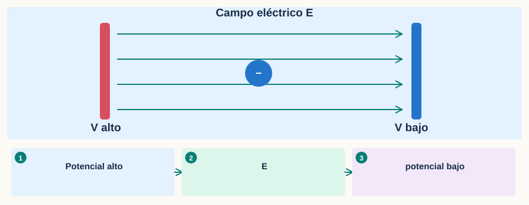

[← Anterior](02.md) · [Índice](../README.md) · [Siguiente →](04.md)

# 03 · Trabajo del campo y polaridad

*Diagrama didáctico y secuencia conceptual; no a escala.*

## ¿Qué es y por qué ocurre?

En electrostática, Wcampo=−ΔU. Una carga positiva libre tiende a acelerar hacia menor potencial; una negativa hacia mayor potencial, si solo actúa el campo eléctrico. La dirección de E es de potencial decreciente; para placas ideales, |E|=|ΔV|/d.

## Ejemplo explicado

> +1 µC cae de 6 V a 2 V: ΔU=−4 µJ; el campo hace +4 µJ de trabajo.

## Ahora tú

−2 µC va de 0 V a 5 V. Calcula ΔU y Wcampo.

[← Anterior](02.md) · [Índice](../README.md) · [Siguiente →](04.md)
