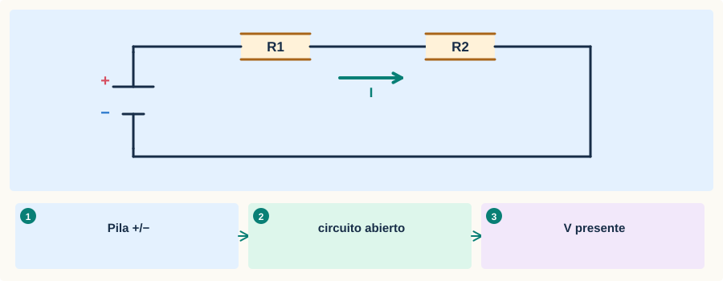

[← Anterior](03.md) · [Índice](../README.md) · [Siguiente →](05.md)

# 04 · Pila desconectada: voltaje sin corriente

*Diagrama didáctico y secuencia conceptual; no a escala.*

## ¿Qué es y por qué ocurre?

Procesos químicos separan carga y mantienen una diferencia de potencial entre bornes. Una pila de 1,5 V ideal puede transferir 1,5 J por cada culombio que circula en el circuito externo. Si el circuito está abierto no hay corriente sostenida, pero la tensión entre terminales puede existir.

## Ejemplo explicado

> Una pila de 6 V que transfiere 2 C entrega 12 J en el modelo ideal.

## Ahora tú

¿Qué significa 9 V en J/C? ¿Es lo mismo que 9 A?

[← Anterior](03.md) · [Índice](../README.md) · [Siguiente →](05.md)
