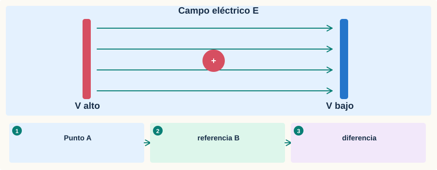

[← Anterior](04.md) · [Índice](../README.md) · [Siguiente →](06.md)

# 05 · Voltaje entre dos puntos

*Diagrama didáctico y secuencia conceptual; no a escala.*

## ¿Qué es y por qué ocurre?

El voltímetro compara potenciales: VAB=VA−VB. Si A=5 V y B=2 V, VAB=3 V; VBA=−3 V. El signo depende de qué punto se usa como referencia. Una tensión no es una cantidad de electrones ni mide la rapidez de flujo.

## Ejemplo explicado

> En una placa electrónica, GND se toma como referencia 0 V; un pin a 3,3 V tiene 3,3 V respecto a GND.

## Ahora tú

VA=−2 V, VB=4 V. ¿VAB?

[← Anterior](04.md) · [Índice](../README.md) · [Siguiente →](06.md)
