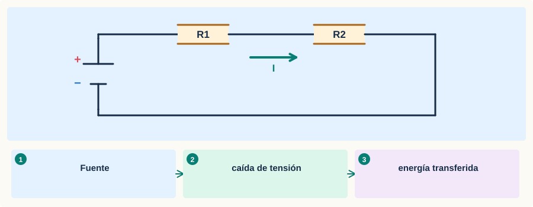

[← Anterior](05.md) · [Índice](../README.md) · [Actividades y cierre →](../descargas.md)

# 06 · Puente a los circuitos

*Diagrama didáctico y secuencia conceptual; no a escala.*

## ¿Qué es y por qué ocurre?

El voltaje permite calcular energía transferida por carga. En una resistencia con corriente convencional del potencial alto al bajo, la energía potencial de las cargas disminuye y se transfiere al material. En la fuente, otros procesos la reponen. No se consumen electrones.

## Ejemplo explicado

> Con 3 C que atraviesan una caída de 4 V, se transfieren 12 J al elemento si no hay otros procesos.

## Ahora tú

¿Qué energía transfiere una caída de 2 V al pasar 5 C?

[← Anterior](05.md) · [Índice](../README.md) · [Actividades y cierre →](../descargas.md)
