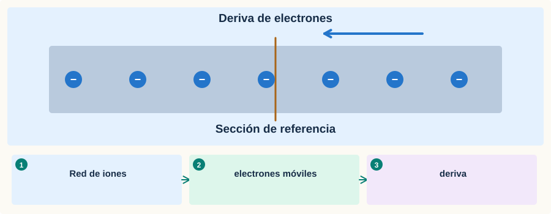
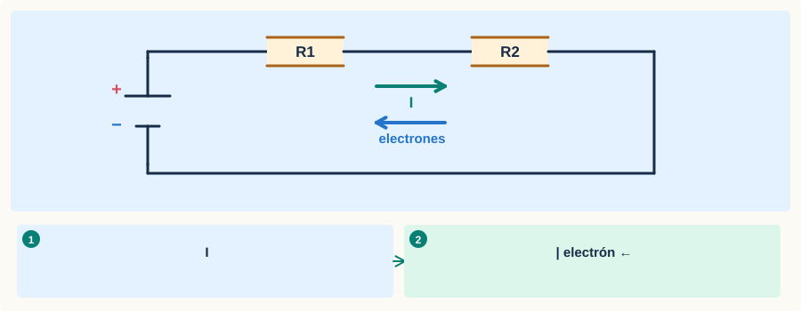
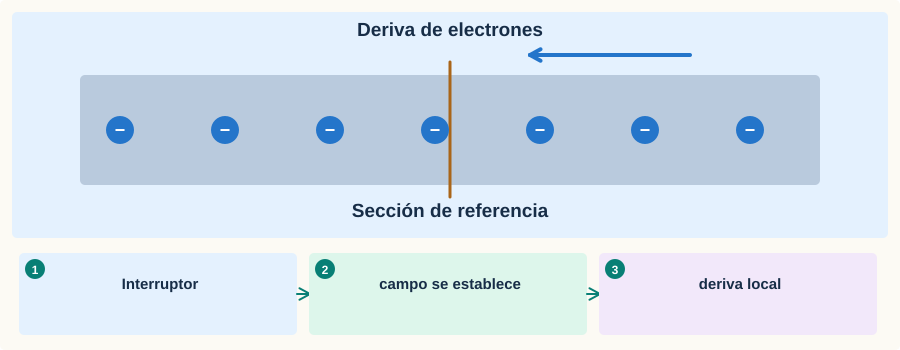
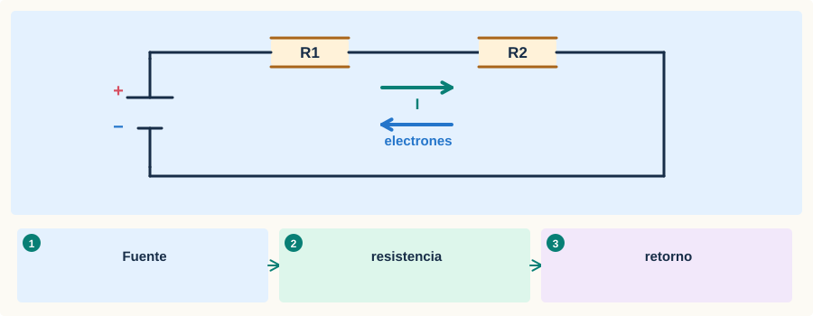
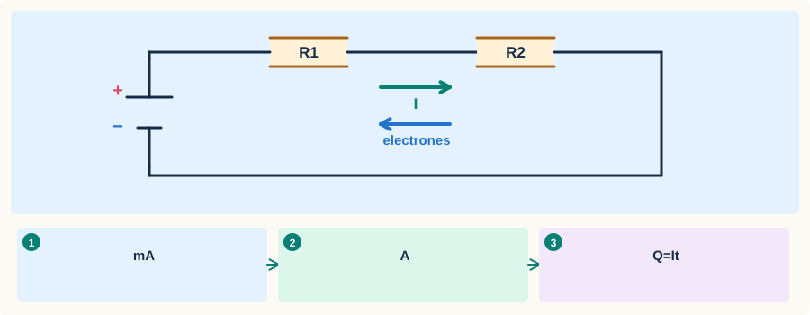

# Cuaderno de ejercicios · Clase 005

[PDF](005-ejercicios.pdf) · [← Índice](../README.md)

## 1. Corriente: flujo de carga

**Ejemplo de estudio:** Si atraviesan 6 C en 3 s, I=2 A.

**Resuelve:** 12 C cruzan en 4 s. Calcula I.

Escribe datos, procedimiento, unidades (si corresponde), dibujo y justificación. No consultes la solución antes.

## 2. Portadores y neutralidad

**Ejemplo de estudio:** Un conductor neutro no tiene carga neta, pero puede transportar corriente.

**Resuelve:** ¿Un cable neutro es necesariamente incapaz de conducir?

Escribe datos, procedimiento, unidades (si corresponde), dibujo y justificación. No consultes la solución antes.

## 3. Sentido convencional frente a electrones

**Ejemplo de estudio:** En un tramo con corriente convencional hacia la derecha, la deriva electrónica es hacia la izquierda.

**Resuelve:** Dibuja I hacia arriba. ¿Hacia dónde deriva el electrón en metal?

Escribe datos, procedimiento, unidades (si corresponde), dibujo y justificación. No consultes la solución antes.

## 4. Señal y deriva no tienen la misma rapidez

**Ejemplo de estudio:** Como analogía limitada, una fila de fichas puede transmitir un empuje aunque cada ficha se desplace poco. No representa literalmente el campo electromagnético.

**Resuelve:** ¿Qué se propaga rápidamente: el electrón individual o la perturbación electromagnética?

Escribe datos, procedimiento, unidades (si corresponde), dibujo y justificación. No consultes la solución antes.

## 5. Circuito cerrado y conservación de carga

**Ejemplo de estudio:** Si 0,2 A cruzan una resistencia durante 10 s, pasan 2 C por cada terminal en régimen estacionario.

**Resuelve:** 0,05 A durante 20 s: ¿cuánta carga cruza?

Escribe datos, procedimiento, unidades (si corresponde), dibujo y justificación. No consultes la solución antes.

## 6. Escalas y aplicaciones

**Ejemplo de estudio:** 20 mA=0,020 A. Una carga de 1,2 C en 60 s equivale a 20 mA.

**Resuelve:** Convierte 350 mA a A y calcula Q en 2 s.

Escribe datos, procedimiento, unidades (si corresponde), dibujo y justificación. No consultes la solución antes.
