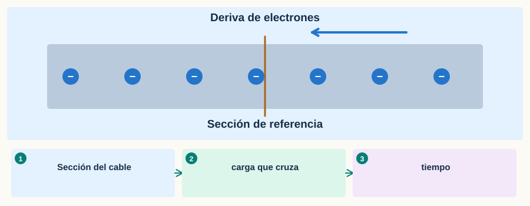
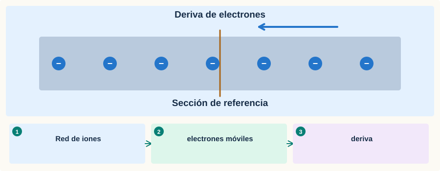
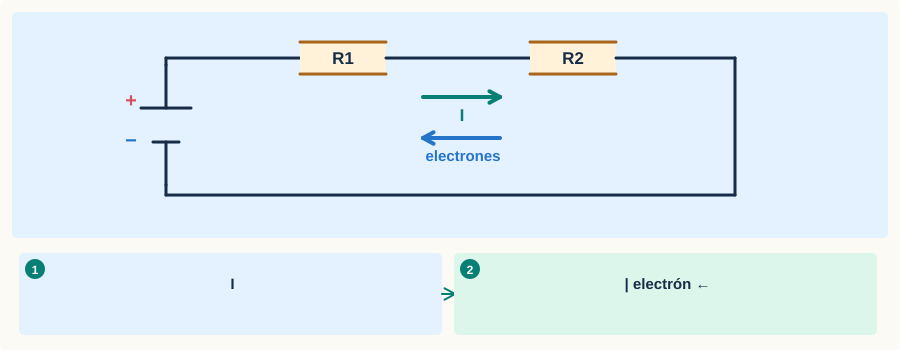
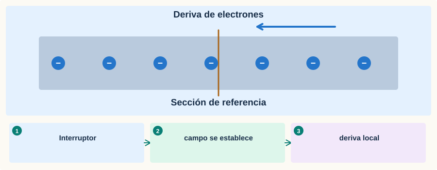
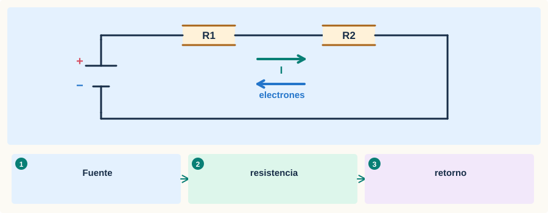
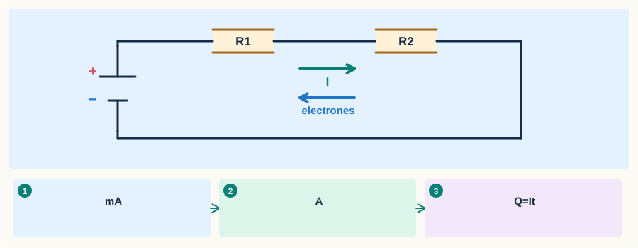

# Corriente eléctrica y movimiento de electrones

[← Índice](../README.md)

## 01 · Corriente: flujo de carga

La corriente media es I=ΔQ/Δt, con signo según un sentido de referencia. Un amperio equivale a un culombio por segundo. La carga que cruza una sección de cable no es lo mismo que la cantidad de carga presente en todo el cable.

**Ejemplo:** Si atraviesan 6 C en 3 s, I=2 A.

**Aplica:** 12 C cruzan en 4 s. Calcula I.

---

## 02 · Portadores y neutralidad

Un metal puede ser globalmente neutro y contener electrones móviles. Sin campo aplicado, sus movimientos microscópicos no generan deriva neta. Con campo, aparece una pequeña velocidad media de deriva; los iones de la red no se desplazan a lo largo del cable como los electrones.

**Ejemplo:** Un conductor neutro no tiene carga neta, pero puede transportar corriente.

**Aplica:** ¿Un cable neutro es necesariamente incapaz de conducir?

---

## 03 · Sentido convencional frente a electrones

Se define corriente convencional en la dirección de flujo de carga positiva. En un cable metálico externo de una pila, la corriente va del borne positivo al negativo; los electrones derivan en sentido contrario. En otros medios puede haber portadores positivos, negativos o ambos.

**Ejemplo:** En un tramo con corriente convencional hacia la derecha, la deriva electrónica es hacia la izquierda.

**Aplica:** Dibuja I hacia arriba. ¿Hacia dónde deriva el electrón en metal?

---

## 04 · Señal y deriva no tienen la misma rapidez

Al cerrar un interruptor, el campo electromagnético se reorganiza a través del circuito a una velocidad finita que depende del medio y geometría, normalmente mucho mayor que la velocidad de deriva. Los portadores ya existen a lo largo del conductor. No hace falta que un electrón individual recorra toda la distancia antes de que la lámpara responda.

**Ejemplo:** Como analogía limitada, una fila de fichas puede transmitir un empuje aunque cada ficha se desplace poco. No representa literalmente el campo electromagnético.

**Aplica:** ¿Qué se propaga rápidamente: el electrón individual o la perturbación electromagnética?

---

## 05 · Circuito cerrado y conservación de carga

En un circuito DC ideal cerrado se establece corriente sostenida si la fuente mantiene tensión. En un circuito abierto no hay trayectoria completa para esa corriente. En régimen estacionario, no se acumula carga indefinidamente en un tramo: entra tanta carga por tiempo como sale.

**Ejemplo:** Si 0,2 A cruzan una resistencia durante 10 s, pasan 2 C por cada terminal en régimen estacionario.

**Aplica:** 0,05 A durante 20 s: ¿cuánta carga cruza?

---

## 06 · Escalas y aplicaciones

Los circuitos electrónicos suelen usar miliamperios: 1 mA=10⁻³ A. La corriente máxima depende de la fuente, carga y protecciones; una fuente de 5 V no impone por sí sola un número fijo de amperios. La capacidad de una batería en Ah mide carga, no corriente instantánea.

**Ejemplo:** 20 mA=0,020 A. Una carga de 1,2 C en 60 s equivale a 20 mA.

**Aplica:** Convierte 350 mA a A y calcula Q en 2 s.

---
