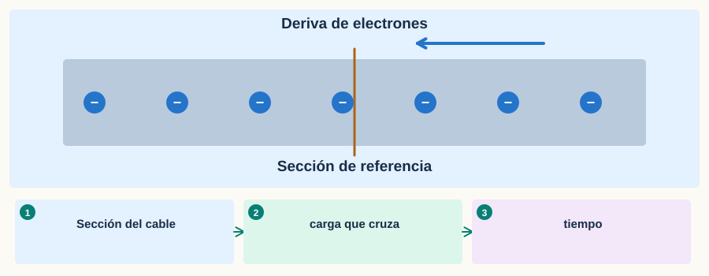

[← Portada](../README.md) · [Índice](../README.md) · [Siguiente →](02.md)

# 01 · Corriente: flujo de carga

*Diagrama didáctico y secuencia conceptual; no a escala.*

## ¿Qué es y por qué ocurre?

La corriente media es I=ΔQ/Δt, con signo según un sentido de referencia. Un amperio equivale a un culombio por segundo. La carga que cruza una sección de cable no es lo mismo que la cantidad de carga presente en todo el cable.

## Ejemplo explicado

> Si atraviesan 6 C en 3 s, I=2 A.

## Ahora tú

12 C cruzan en 4 s. Calcula I.

[← Portada](../README.md) · [Índice](../README.md) · [Siguiente →](02.md)
