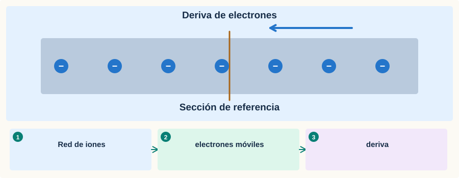
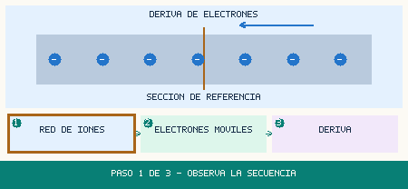

[← Anterior](01.md) · [Índice](../README.md) · [Siguiente →](03.md)

# 02 · Portadores y neutralidad

*Diagrama didáctico y secuencia conceptual; no a escala.*

## ¿Qué es y por qué ocurre?

Un metal puede ser globalmente neutro y contener electrones móviles. Sin campo aplicado, sus movimientos microscópicos no generan deriva neta. Con campo, aparece una pequeña velocidad media de deriva; los iones de la red no se desplazan a lo largo del cable como los electrones.

## Ejemplo explicado

> Un conductor neutro no tiene carga neta, pero puede transportar corriente.

## Ahora tú

¿Un cable neutro es necesariamente incapaz de conducir?

## Secuencia animada

*Se resaltan etapas del diagrama, no se pretende simular el movimiento físico real.*

[← Anterior](01.md) · [Índice](../README.md) · [Siguiente →](03.md)
