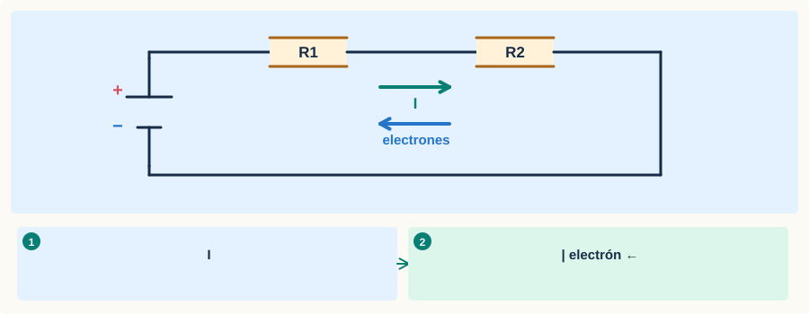

[← Anterior](02.md) · [Índice](../README.md) · [Siguiente →](04.md)

# 03 · Sentido convencional frente a electrones

*Diagrama didáctico y secuencia conceptual; no a escala.*

## ¿Qué es y por qué ocurre?

Se define corriente convencional en la dirección de flujo de carga positiva. En un cable metálico externo de una pila, la corriente va del borne positivo al negativo; los electrones derivan en sentido contrario. En otros medios puede haber portadores positivos, negativos o ambos.

## Ejemplo explicado

> En un tramo con corriente convencional hacia la derecha, la deriva electrónica es hacia la izquierda.

## Ahora tú

Dibuja I hacia arriba. ¿Hacia dónde deriva el electrón en metal?

[← Anterior](02.md) · [Índice](../README.md) · [Siguiente →](04.md)
