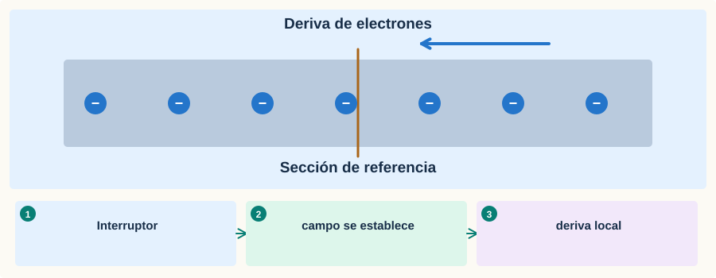

[← Anterior](03.md) · [Índice](../README.md) · [Siguiente →](05.md)

# 04 · Señal y deriva no tienen la misma rapidez

*Diagrama didáctico y secuencia conceptual; no a escala.*

## ¿Qué es y por qué ocurre?

Al cerrar un interruptor, el campo electromagnético se reorganiza a través del circuito a una velocidad finita que depende del medio y geometría, normalmente mucho mayor que la velocidad de deriva. Los portadores ya existen a lo largo del conductor. No hace falta que un electrón individual recorra toda la distancia antes de que la lámpara responda.

## Ejemplo explicado

> Como analogía limitada, una fila de fichas puede transmitir un empuje aunque cada ficha se desplace poco. No representa literalmente el campo electromagnético.

## Ahora tú

¿Qué se propaga rápidamente: el electrón individual o la perturbación electromagnética?

[← Anterior](03.md) · [Índice](../README.md) · [Siguiente →](05.md)
