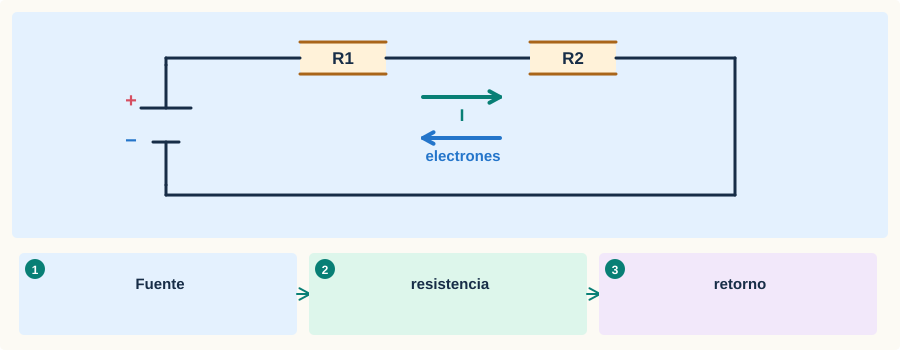

[← Anterior](04.md) · [Índice](../README.md) · [Siguiente →](06.md)

# 05 · Circuito cerrado y conservación de carga

*Diagrama didáctico y secuencia conceptual; no a escala.*

## ¿Qué es y por qué ocurre?

En un circuito DC ideal cerrado se establece corriente sostenida si la fuente mantiene tensión. En un circuito abierto no hay trayectoria completa para esa corriente. En régimen estacionario, no se acumula carga indefinidamente en un tramo: entra tanta carga por tiempo como sale.

## Ejemplo explicado

> Si 0,2 A cruzan una resistencia durante 10 s, pasan 2 C por cada terminal en régimen estacionario.

## Ahora tú

0,05 A durante 20 s: ¿cuánta carga cruza?

[← Anterior](04.md) · [Índice](../README.md) · [Siguiente →](06.md)
