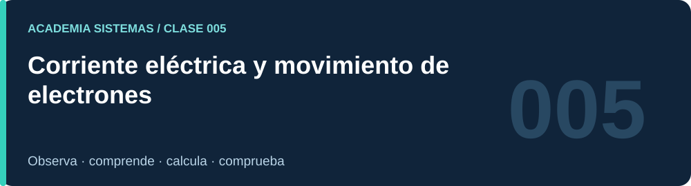
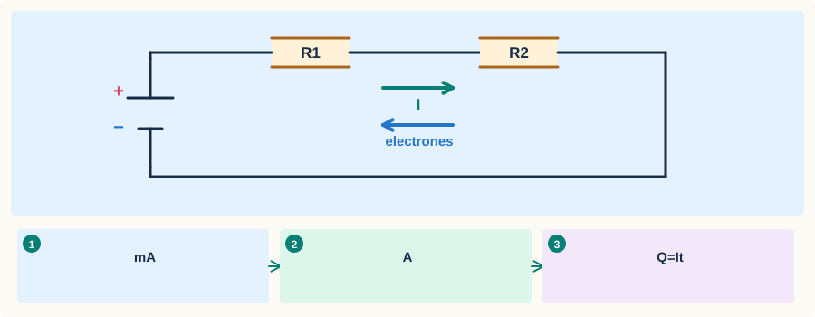

[← Anterior](05.md) · [Índice](../README.md) · [Actividades y cierre →](../descargas.md)

# 06 · Escalas y aplicaciones

*Diagrama didáctico y secuencia conceptual; no a escala.*

## ¿Qué es y por qué ocurre?

Los circuitos electrónicos suelen usar miliamperios: 1 mA=10⁻³ A. La corriente máxima depende de la fuente, carga y protecciones; una fuente de 5 V no impone por sí sola un número fijo de amperios. La capacidad de una batería en Ah mide carga, no corriente instantánea.

## Ejemplo explicado

> 20 mA=0,020 A. Una carga de 1,2 C en 60 s equivale a 20 mA.

## Ahora tú

Convierte 350 mA a A y calcula Q en 2 s.

[← Anterior](05.md) · [Índice](../README.md) · [Actividades y cierre →](../descargas.md)
