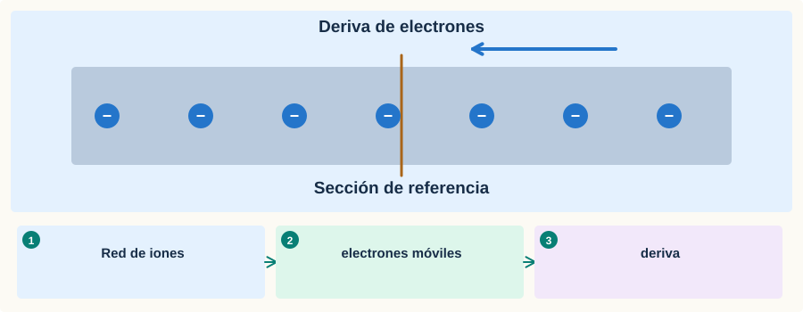

# Práctica guiada · Corriente eléctrica y movimiento de electrones

**Objetivo:** ¿Por qué una lámpara enciende sin esperar que un electrón recorra todo el cable?

## Procedimiento

Simula una fuente con interruptor y lámpara en PhET Circuit Construction Kit DC. Observa corriente al abrir y cerrar; cambia carga en simulación. Registra sentidos y predice Q en 10 s. No conectes aún multímetro.

1. Formula hipótesis y dibuja el modelo antes de intervenir.
2. Identifica magnitudes que cambian y las que permanecen fijas.
3. Realiza solo el procedimiento seguro descrito; registra resultados y unidades.
4. Compara con predicción; explica diferencias, incertidumbre y limitaciones.

| Ensayo | Condiciones | Predicción | Observación o cálculo | Explicación |
|---|---|---|---|---|
| 1 | | | | |
| 2 | | | | |
| 3 | | | | |

Rúbrica: predicción 25, registro 25, explicación 40, presentación 10. Seguridad obligatoria. En simulación, los resultados calculados no son evidencia experimental independiente.

[Simulador complementario PhET](https://phet.colorado.edu/es/simulations/circuit-construction-kit-dc) · [Plantilla de informe](../../../../../plantillas/informe-laboratorio.pdf) · [PDF](005-laboratorio.pdf) · [← Índice](../README.md)
