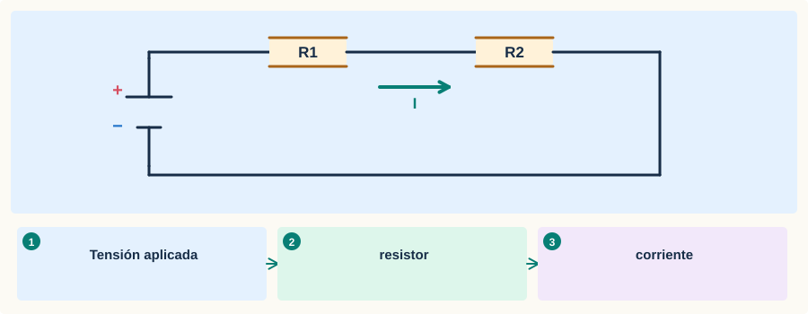

[← Clase 005](../005-corriente-electrica/README.md) · [Índice](../README.md) · [Clase 007 →](../007-ley-ohm/README.md)

# Clase 006 · Resistencia eléctrica y resistividad

**6 temas desarrollados · 120–180 min orientativos, ampliables por dominio.**

> ¿Qué cambia al aumentar la longitud o reducir el grosor de un cable?

[▶ Comenzar a leer](libro/01.md) · [Libro web](https://mangelmorenomoreno.github.io/academia-sistemas/modulos/01-electronica-basica/clases/006-resistencia-resistividad/libro.html) · [Descargas](descargas.md)

| Página | Tema |
|---|---|
| 01 | [Resistencia y resistor](libro/01.md) |
| 02 | [Origen microscópico](libro/02.md) |
| 03 | [Resistividad: propiedad del material](libro/03.md) |
| 04 | [Longitud: más recorrido](libro/04.md) |
| 05 | [Área y diámetro](libro/05.md) |
| 06 | [Cálculo real y temperatura](libro/06.md) |

## Material de estudio

[Lectura completa](lecturas/guia-ampliada.md) · [Presentación web](https://mangelmorenomoreno.github.io/academia-sistemas/modulos/01-electronica-basica/clases/006-resistencia-resistividad/presentacion.html) · [Ejercicios](ejercicios/README.md) · [Práctica](practicas/README.md) · [Evaluación](pruebas/README.md) · [Soluciones](soluciones/README.md) · [Guía docente](guia-docente.md) · [Recursos](recursos/videos-y-simulaciones.md)

> [!CAUTION]
> Antes de la clase 013, utiliza simulación y materiales desconectados. Nunca trabajar con la red doméstica, provocar cortos ni utilizar componentes dañados.

[← Clase 005](../005-corriente-electrica/README.md) · [Índice](../README.md) · [Clase 007 →](../007-ley-ohm/README.md)
