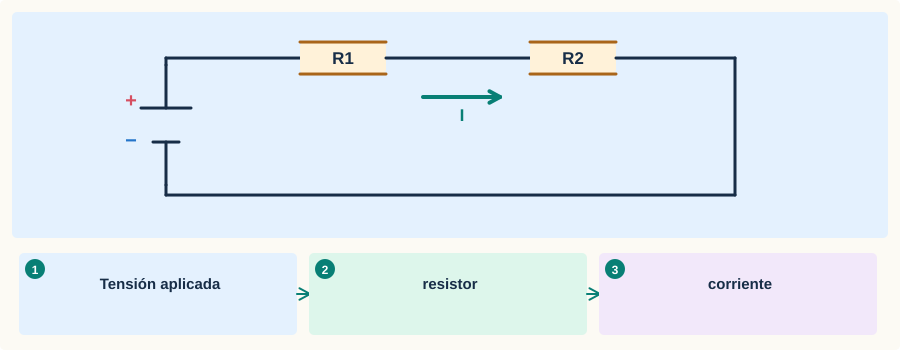
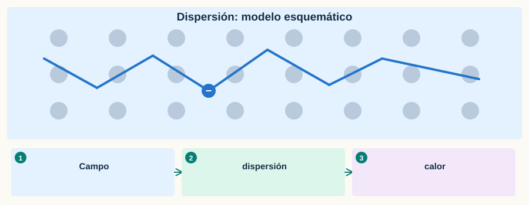
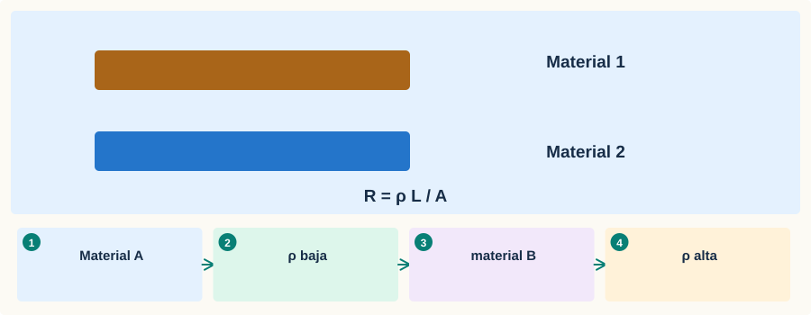
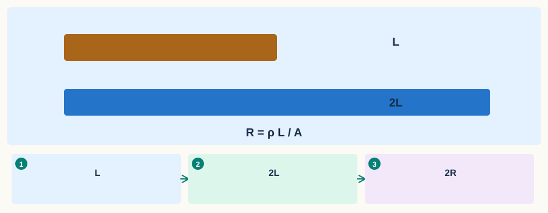
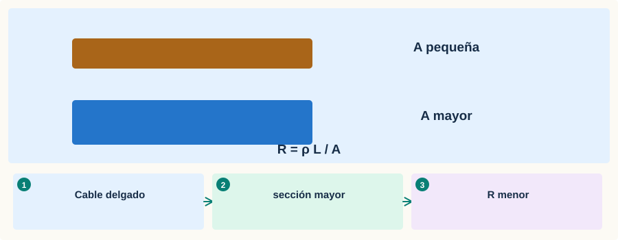
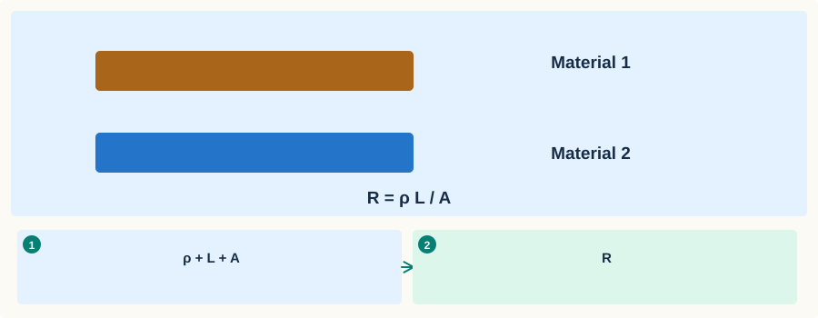

# Cuaderno de ejercicios · Clase 006

[PDF](006-ejercicios.pdf) · [← Índice](../README.md)

## 1. Resistencia y resistor

**Ejemplo de estudio:** Un resistor con 2 V y 0,01 A presenta 200 Ω.

**Resuelve:** Si V=4 V e I=0,02 A, calcula R.

Escribe datos, procedimiento, unidades (si corresponde), dibujo y justificación. No consultes la solución antes.

## 2. Origen microscópico

**Ejemplo de estudio:** Al calentarse muchos metales, aumentan las vibraciones y su resistencia tiende a crecer.

**Resuelve:** ¿El resistor consume electrones?

Escribe datos, procedimiento, unidades (si corresponde), dibujo y justificación. No consultes la solución antes.

## 3. Resistividad: propiedad del material

**Ejemplo de estudio:** Con igual L y A, un material con doble ρ tiene doble R.

**Resuelve:** Si dos cables tienen igual geometría y ρB=3ρA, compara R.

Escribe datos, procedimiento, unidades (si corresponde), dibujo y justificación. No consultes la solución antes.

## 4. Longitud: más recorrido

**Ejemplo de estudio:** R=0,5 Ω a 1 m; a 4 m con igual A y ρ será 2 Ω.

**Resuelve:** Una pieza de 3 Ω mide 2 m; ¿R a 6 m?

Escribe datos, procedimiento, unidades (si corresponde), dibujo y justificación. No consultes la solución antes.

## 5. Área y diámetro

**Ejemplo de estudio:** Si R=8 Ω y se duplica el diámetro sin variar L ni ρ, R=2 Ω.

**Resuelve:** Si A se triplica, ¿qué ocurre con R=12 Ω?

Escribe datos, procedimiento, unidades (si corresponde), dibujo y justificación. No consultes la solución antes.

## 6. Cálculo real y temperatura

**Ejemplo de estudio:** Si ese mismo cable mide 10 m, R≈0,168 Ω.

**Resuelve:** Con ρ=2×10⁻⁸, L=5 m, A=2 mm², calcula R.

Escribe datos, procedimiento, unidades (si corresponde), dibujo y justificación. No consultes la solución antes.
