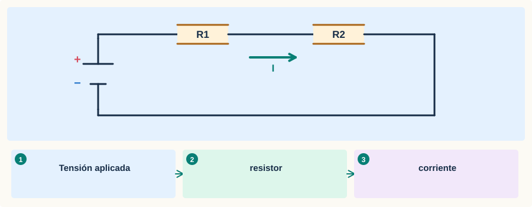
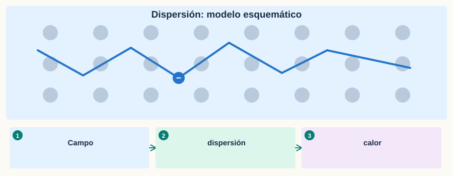
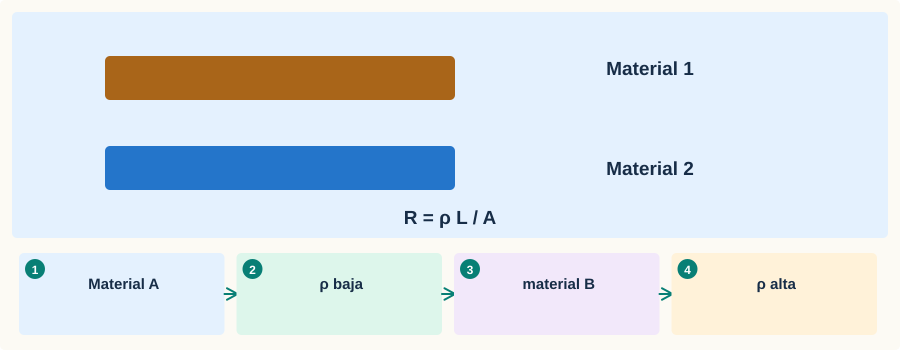
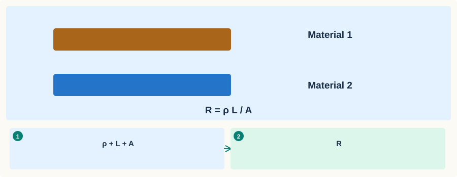

# Resistencia eléctrica y resistividad

[← Índice](../README.md)

## 01 · Resistencia y resistor

La resistencia eléctrica cuantifica la oposición al transporte de corriente en una condición dada. Un resistor es un componente diseñado para presentar cierta resistencia. En un elemento óhmico R=V/I es constante a temperatura aproximadamente fija. La unidad es el ohmio (Ω=V/A).

**Ejemplo:** Un resistor con 2 V y 0,01 A presenta 200 Ω.

**Aplica:** Si V=4 V e I=0,02 A, calcula R.

---

## 02 · Origen microscópico

En un metal, el campo acelera portadores entre interacciones de dispersión con vibraciones de la red, impurezas y defectos. La dispersión limita la deriva y facilita transferencia de energía al material. El modelo no describe electrones como bolitas chocando literalmente; la física microscópica es cuántica.

**Ejemplo:** Al calentarse muchos metales, aumentan las vibraciones y su resistencia tiende a crecer.

**Aplica:** ¿El resistor consume electrones?

---

## 03 · Resistividad: propiedad del material

La resistividad ρ expresa cuánto se opone un material al transporte en condiciones especificadas. Se mide en Ω·m. En una pieza homogénea de sección uniforme, R=ρL/A. Un metal y un aislante pueden tener resistividades muy diferentes; temperatura y composición importan.

**Ejemplo:** Con igual L y A, un material con doble ρ tiene doble R.

**Aplica:** Si dos cables tienen igual geometría y ρB=3ρA, compara R.

---

## 04 · Longitud: más recorrido

Al duplicar L con la misma sección y resistividad, R se duplica. Se puede interpretar como dos tramos iguales en serie. No es correcto afirmar que todos los cables largos tienen más resistencia que cualquier cable corto: también importa A y ρ.

**Ejemplo:** R=0,5 Ω a 1 m; a 4 m con igual A y ρ será 2 Ω.

**Aplica:** Una pieza de 3 Ω mide 2 m; ¿R a 6 m?

---

## 05 · Área y diámetro

La sección transversal A representa el espacio disponible para transporte. Al duplicar A, R se reduce a la mitad. Para un conductor circular A=πd²/4: duplicar el diámetro cuadruplica A, por lo que R se divide por cuatro.

**Ejemplo:** Si R=8 Ω y se duplica el diámetro sin variar L ni ρ, R=2 Ω.

**Aplica:** Si A se triplica, ¿qué ocurre con R=12 Ω?

---

## 06 · Cálculo real y temperatura

Para cobre a unos 20 °C, ρ≈1,68×10⁻⁸ Ω·m. Un cable de L=2 m y A=1 mm²=10⁻⁶ m² tiene R≈0,0336 Ω. El resultado depende de temperatura y pureza. No debe usarse R=ρL/A en componentes de geometría y comportamiento arbitrarios sin verificar supuestos.

**Ejemplo:** Si ese mismo cable mide 10 m, R≈0,168 Ω.

**Aplica:** Con ρ=2×10⁻⁸, L=5 m, A=2 mm², calcula R.

---
