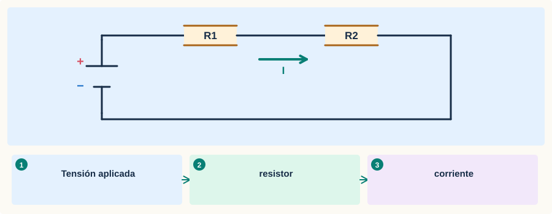

[← Portada](../README.md) · [Índice](../README.md) · [Siguiente →](02.md)

# 01 · Resistencia y resistor

*Diagrama didáctico y secuencia conceptual; no a escala.*

## ¿Qué es y por qué ocurre?

La resistencia eléctrica cuantifica la oposición al transporte de corriente en una condición dada. Un resistor es un componente diseñado para presentar cierta resistencia. En un elemento óhmico R=V/I es constante a temperatura aproximadamente fija. La unidad es el ohmio (Ω=V/A).

## Ejemplo explicado

> Un resistor con 2 V y 0,01 A presenta 200 Ω.

## Ahora tú

Si V=4 V e I=0,02 A, calcula R.

[← Portada](../README.md) · [Índice](../README.md) · [Siguiente →](02.md)
