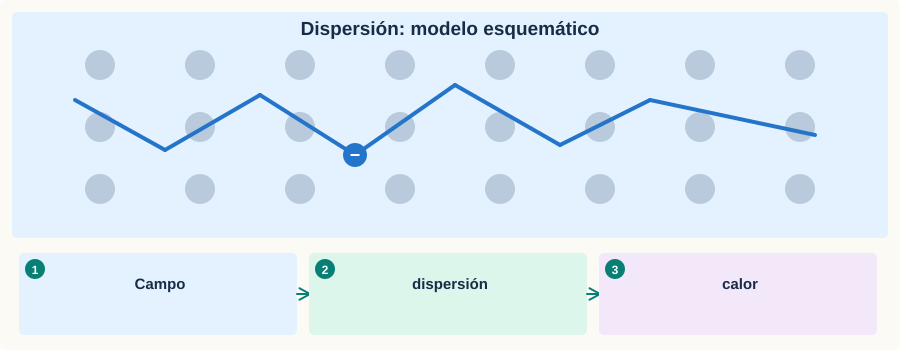
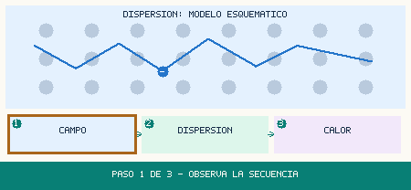

[← Anterior](01.md) · [Índice](../README.md) · [Siguiente →](03.md)

# 02 · Origen microscópico

*Diagrama didáctico y secuencia conceptual; no a escala.*

## ¿Qué es y por qué ocurre?

En un metal, el campo acelera portadores entre interacciones de dispersión con vibraciones de la red, impurezas y defectos. La dispersión limita la deriva y facilita transferencia de energía al material. El modelo no describe electrones como bolitas chocando literalmente; la física microscópica es cuántica.

## Ejemplo explicado

> Al calentarse muchos metales, aumentan las vibraciones y su resistencia tiende a crecer.

## Ahora tú

¿El resistor consume electrones?

## Secuencia animada

*Se resaltan etapas del diagrama, no se pretende simular el movimiento físico real.*

[← Anterior](01.md) · [Índice](../README.md) · [Siguiente →](03.md)
