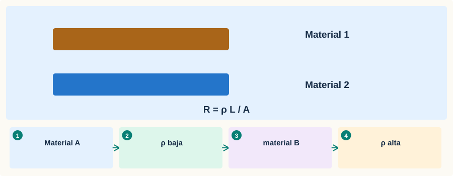

[← Anterior](02.md) · [Índice](../README.md) · [Siguiente →](04.md)

# 03 · Resistividad: propiedad del material

*Diagrama didáctico y secuencia conceptual; no a escala.*

## ¿Qué es y por qué ocurre?

La resistividad ρ expresa cuánto se opone un material al transporte en condiciones especificadas. Se mide en Ω·m. En una pieza homogénea de sección uniforme, R=ρL/A. Un metal y un aislante pueden tener resistividades muy diferentes; temperatura y composición importan.

## Ejemplo explicado

> Con igual L y A, un material con doble ρ tiene doble R.

## Ahora tú

Si dos cables tienen igual geometría y ρB=3ρA, compara R.

[← Anterior](02.md) · [Índice](../README.md) · [Siguiente →](04.md)
