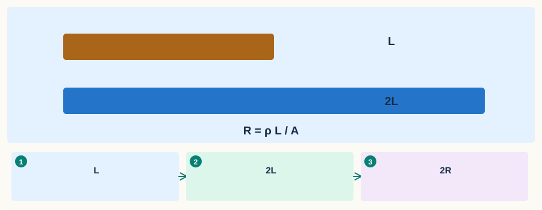

[← Anterior](03.md) · [Índice](../README.md) · [Siguiente →](05.md)

# 04 · Longitud: más recorrido

*Diagrama didáctico y secuencia conceptual; no a escala.*

## ¿Qué es y por qué ocurre?

Al duplicar L con la misma sección y resistividad, R se duplica. Se puede interpretar como dos tramos iguales en serie. No es correcto afirmar que todos los cables largos tienen más resistencia que cualquier cable corto: también importa A y ρ.

## Ejemplo explicado

> R=0,5 Ω a 1 m; a 4 m con igual A y ρ será 2 Ω.

## Ahora tú

Una pieza de 3 Ω mide 2 m; ¿R a 6 m?

[← Anterior](03.md) · [Índice](../README.md) · [Siguiente →](05.md)
