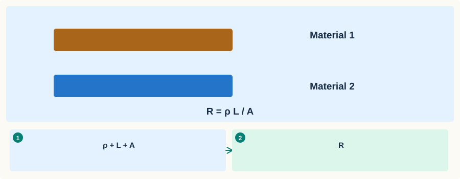

[← Anterior](05.md) · [Índice](../README.md) · [Actividades y cierre →](../descargas.md)

# 06 · Cálculo real y temperatura

*Diagrama didáctico y secuencia conceptual; no a escala.*

## ¿Qué es y por qué ocurre?

Para cobre a unos 20 °C, ρ≈1,68×10⁻⁸ Ω·m. Un cable de L=2 m y A=1 mm²=10⁻⁶ m² tiene R≈0,0336 Ω. El resultado depende de temperatura y pureza. No debe usarse R=ρL/A en componentes de geometría y comportamiento arbitrarios sin verificar supuestos.

## Ejemplo explicado

> Si ese mismo cable mide 10 m, R≈0,168 Ω.

## Ahora tú

Con ρ=2×10⁻⁸, L=5 m, A=2 mm², calcula R.

[← Anterior](05.md) · [Índice](../README.md) · [Actividades y cierre →](../descargas.md)
