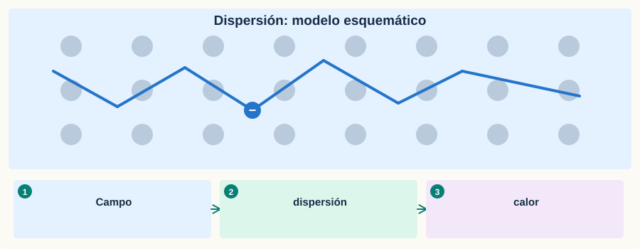

# Práctica guiada · Resistencia eléctrica y resistividad

**Objetivo:** ¿Qué cambia al aumentar la longitud o reducir el grosor de un cable?

## Procedimiento

Simula tres cables con igual material: cambia L de 1 a 2 m y A de 1 a 2 mm². Registra R relativa; compara con otro material. Dibuja sección y longitud. No uses corriente real todavía.

1. Formula hipótesis y dibuja el modelo antes de intervenir.
2. Identifica magnitudes que cambian y las que permanecen fijas.
3. Realiza solo el procedimiento seguro descrito; registra resultados y unidades.
4. Compara con predicción; explica diferencias, incertidumbre y limitaciones.

| Ensayo | Condiciones | Predicción | Observación o cálculo | Explicación |
|---|---|---|---|---|
| 1 | | | | |
| 2 | | | | |
| 3 | | | | |

Rúbrica: predicción 25, registro 25, explicación 40, presentación 10. Seguridad obligatoria. En simulación, los resultados calculados no son evidencia experimental independiente.

[Simulador complementario PhET](https://phet.colorado.edu/es/simulations/resistance-in-a-wire) · [Plantilla de informe](../../../../../plantillas/informe-laboratorio.pdf) · [PDF](006-laboratorio.pdf) · [← Índice](../README.md)
