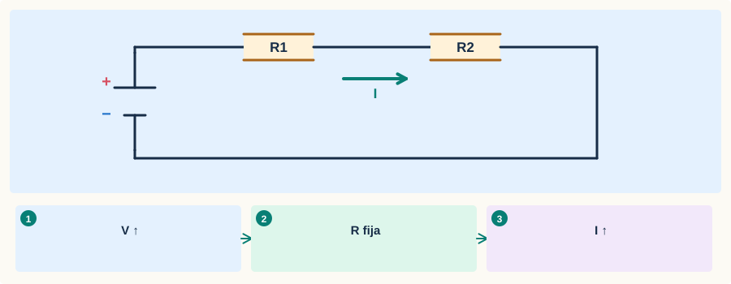
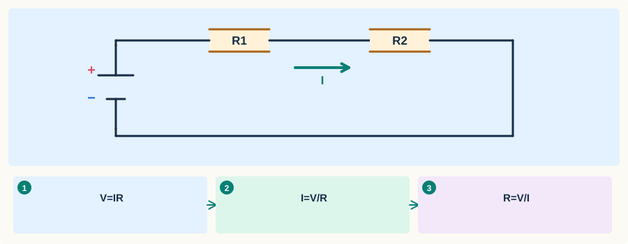
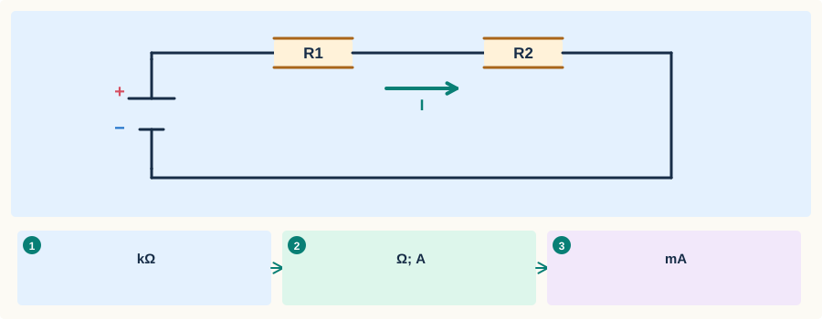
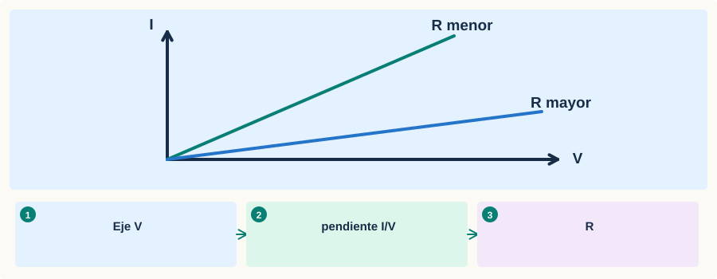
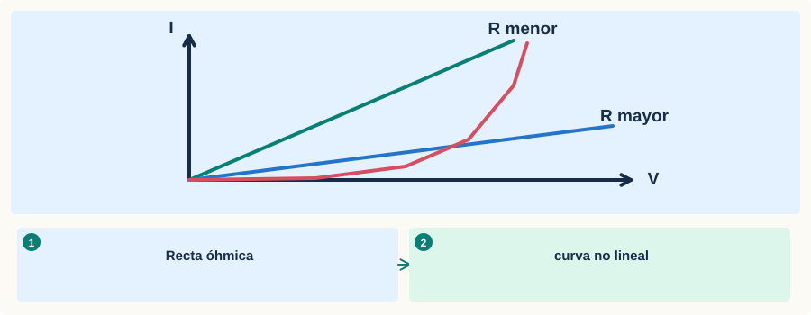
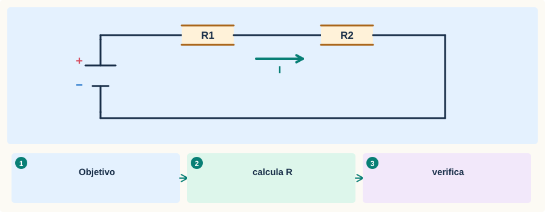

# Cuaderno de ejercicios · Clase 007

[PDF](007-ejercicios.pdf) · [← Índice](../README.md)

## 1. Una relación experimental

**Ejemplo de estudio:** Si R=100 Ω y V pasa de 1 a 2 V, I pasa de 10 a 20 mA.

**Resuelve:** Con R fija, triplica V. ¿Qué ocurre con I?

Escribe datos, procedimiento, unidades (si corresponde), dibujo y justificación. No consultes la solución antes.

## 2. Despejar sin memorizar triángulos

**Ejemplo de estudio:** 6 V y 330 Ω: I=6/330=0,01818 A≈18,2 mA.

**Resuelve:** 12 V y 1 kΩ. Calcula I en mA.

Escribe datos, procedimiento, unidades (si corresponde), dibujo y justificación. No consultes la solución antes.

## 3. Prefijos y orden de magnitud

**Ejemplo de estudio:** 3 V / 2 kΩ = 1,5 mA.

**Resuelve:** 5 V y 470 Ω: I aproximada.

Escribe datos, procedimiento, unidades (si corresponde), dibujo y justificación. No consultes la solución antes.

## 4. Gráfica corriente-voltaje

**Ejemplo de estudio:** Para R=200 Ω la pendiente I/V es 0,005 A/V.

**Resuelve:** ¿Cuál recta I-V es más inclinada: 100 Ω o 1 kΩ?

Escribe datos, procedimiento, unidades (si corresponde), dibujo y justificación. No consultes la solución antes.

## 5. No óhmicos: límites

**Ejemplo de estudio:** Si a 1 V un dispositivo conduce 1 mA y a 2 V conduce 10 mA, V/I cambia de 1 kΩ a 200 Ω.

**Resuelve:** ¿El dispositivo del ejemplo es óhmico entre esos puntos?

Escribe datos, procedimiento, unidades (si corresponde), dibujo y justificación. No consultes la solución antes.

## 6. Diseñar y comprobar

**Ejemplo de estudio:** Para 5 V y una corriente objetivo de 10 mA, R=500 Ω. Un valor comercial 510 Ω da ≈9,8 mA.

**Resuelve:** A 6 V, objetivo 20 mA. ¿R ideal?

Escribe datos, procedimiento, unidades (si corresponde), dibujo y justificación. No consultes la solución antes.
