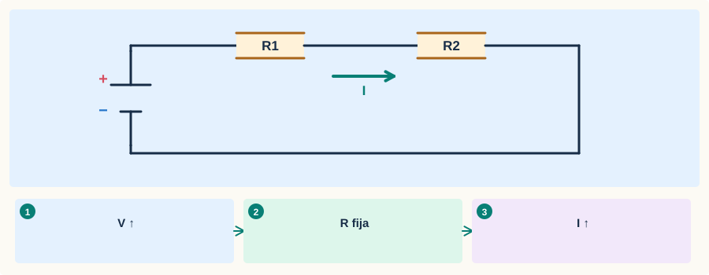
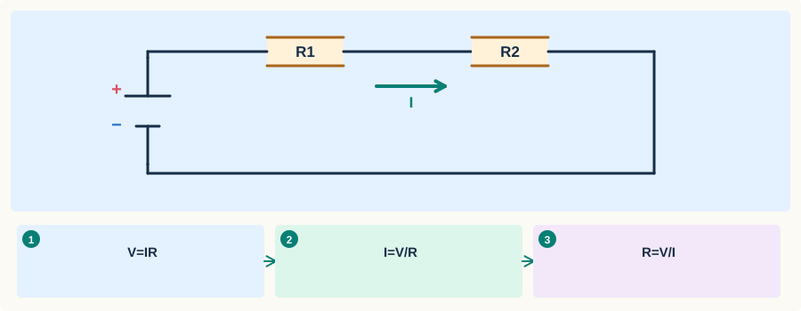
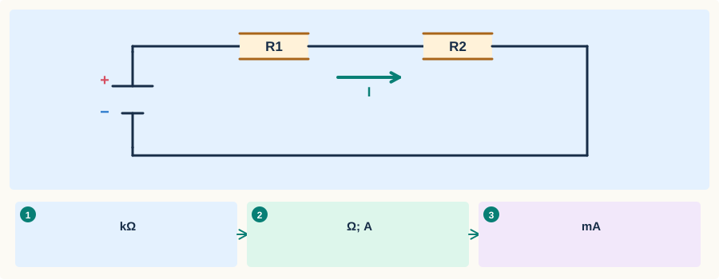
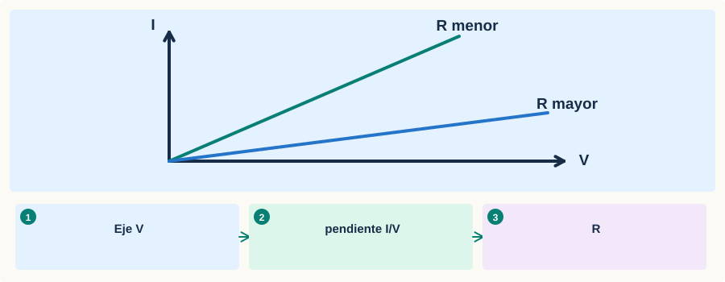
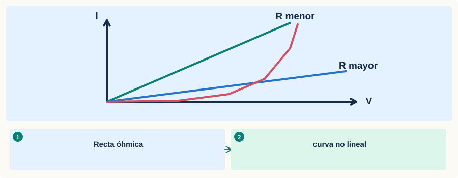
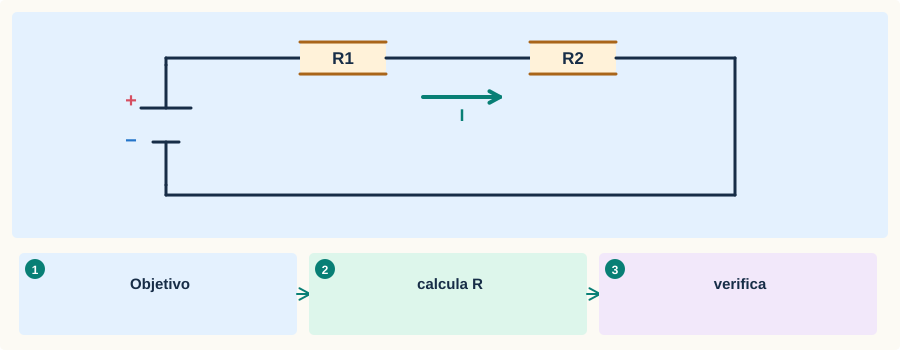

# Ley de Ohm

[← Índice](../README.md)

## 01 · Una relación experimental

Para un conductor óhmico en condiciones físicas estables, la diferencia de potencial es proporcional a la corriente: V=IR. La constante R es resistencia. La ley de Ohm no afirma que cualquier dispositivo tenga una R constante; un diodo o una bombilla que cambia de temperatura puede ser no óhmico.

**Ejemplo:** Si R=100 Ω y V pasa de 1 a 2 V, I pasa de 10 a 20 mA.

**Aplica:** Con R fija, triplica V. ¿Qué ocurre con I?

---

## 02 · Despejar sin memorizar triángulos

Partiendo de V=IR, divide ambos lados por R para I=V/R o por I para R=V/I si el denominador no es cero. Comprueba las unidades: V/Ω=A y V/A=Ω. La tensión se mide entre puntos y la corriente atraviesa una sección.

**Ejemplo:** 6 V y 330 Ω: I=6/330=0,01818 A≈18,2 mA.

**Aplica:** 12 V y 1 kΩ. Calcula I en mA.

---

## 03 · Prefijos y orden de magnitud

1 kΩ=1000 Ω; 1 MΩ=10⁶ Ω; 1 mA=10⁻³ A. Antes de sustituir, convierte a unidades coherentes. Alternativamente, V/kΩ da mA si se usa consistentemente. Una respuesta de cientos de amperios para un resistor de kiloohmios y pila es una señal de error.

**Ejemplo:** 3 V / 2 kΩ = 1,5 mA.

**Aplica:** 5 V y 470 Ω: I aproximada.

---

## 04 · Gráfica corriente-voltaje

En una gráfica I frente a V, el resistor óhmico ideal es una recta que pasa por el origen con pendiente 1/R (A/V). Una resistencia mayor genera una pendiente menor. En una gráfica V frente a I la pendiente sí es R; no confundir los ejes.

**Ejemplo:** Para R=200 Ω la pendiente I/V es 0,005 A/V.

**Aplica:** ¿Cuál recta I-V es más inclinada: 100 Ω o 1 kΩ?

---

## 05 · No óhmicos: límites

Un LED tiene una relación corriente-tensión no lineal y depende de temperatura. Una lámpara incandescente cambia de resistencia al calentarse. Se puede calcular V/I en un punto de funcionamiento, pero eso no vuelve constante la relación. El modelo ideal simplifica el comportamiento.

**Ejemplo:** Si a 1 V un dispositivo conduce 1 mA y a 2 V conduce 10 mA, V/I cambia de 1 kΩ a 200 Ω.

**Aplica:** ¿El dispositivo del ejemplo es óhmico entre esos puntos?

---

## 06 · Diseñar y comprobar

Para limitar una corriente, calcula primero la resistencia y después comprueba la potencia nominal del componente (clase 008). La fuente real puede tener límites y resistencia interna. La ley de Ohm es una herramienta de predicción, no un sustituto de seguridad.

**Ejemplo:** Para 5 V y una corriente objetivo de 10 mA, R=500 Ω. Un valor comercial 510 Ω da ≈9,8 mA.

**Aplica:** A 6 V, objetivo 20 mA. ¿R ideal?

---
