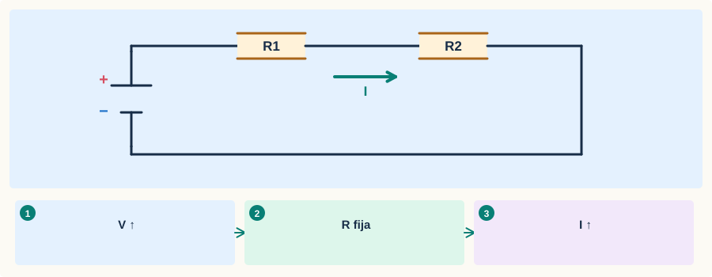

[← Portada](../README.md) · [Índice](../README.md) · [Siguiente →](02.md)

# 01 · Una relación experimental

*Diagrama didáctico y secuencia conceptual; no a escala.*

## ¿Qué es y por qué ocurre?

Para un conductor óhmico en condiciones físicas estables, la diferencia de potencial es proporcional a la corriente: V=IR. La constante R es resistencia. La ley de Ohm no afirma que cualquier dispositivo tenga una R constante; un diodo o una bombilla que cambia de temperatura puede ser no óhmico.

## Ejemplo explicado

> Si R=100 Ω y V pasa de 1 a 2 V, I pasa de 10 a 20 mA.

## Ahora tú

Con R fija, triplica V. ¿Qué ocurre con I?

[← Portada](../README.md) · [Índice](../README.md) · [Siguiente →](02.md)
