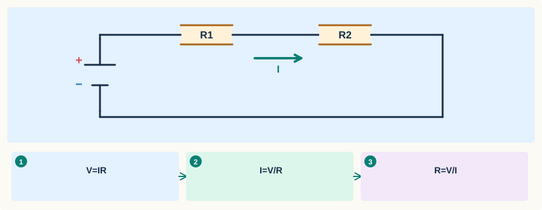
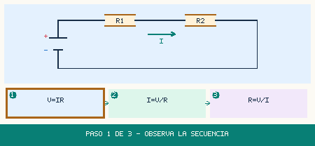

[← Anterior](01.md) · [Índice](../README.md) · [Siguiente →](03.md)

# 02 · Despejar sin memorizar triángulos

*Diagrama didáctico y secuencia conceptual; no a escala.*

## ¿Qué es y por qué ocurre?

Partiendo de V=IR, divide ambos lados por R para I=V/R o por I para R=V/I si el denominador no es cero. Comprueba las unidades: V/Ω=A y V/A=Ω. La tensión se mide entre puntos y la corriente atraviesa una sección.

## Ejemplo explicado

> 6 V y 330 Ω: I=6/330=0,01818 A≈18,2 mA.

## Ahora tú

12 V y 1 kΩ. Calcula I en mA.

## Secuencia animada

*Se resaltan etapas del diagrama, no se pretende simular el movimiento físico real.*

[← Anterior](01.md) · [Índice](../README.md) · [Siguiente →](03.md)
