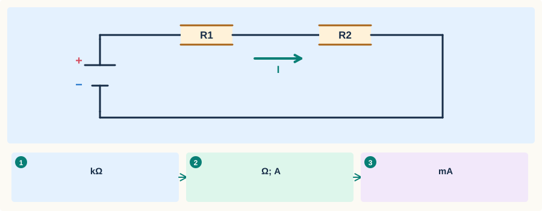

[← Anterior](02.md) · [Índice](../README.md) · [Siguiente →](04.md)

# 03 · Prefijos y orden de magnitud

*Diagrama didáctico y secuencia conceptual; no a escala.*

## ¿Qué es y por qué ocurre?

1 kΩ=1000 Ω; 1 MΩ=10⁶ Ω; 1 mA=10⁻³ A. Antes de sustituir, convierte a unidades coherentes. Alternativamente, V/kΩ da mA si se usa consistentemente. Una respuesta de cientos de amperios para un resistor de kiloohmios y pila es una señal de error.

## Ejemplo explicado

> 3 V / 2 kΩ = 1,5 mA.

## Ahora tú

5 V y 470 Ω: I aproximada.

[← Anterior](02.md) · [Índice](../README.md) · [Siguiente →](04.md)
