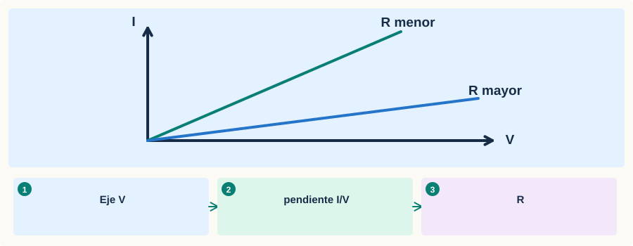

[← Anterior](03.md) · [Índice](../README.md) · [Siguiente →](05.md)

# 04 · Gráfica corriente-voltaje

*Diagrama didáctico y secuencia conceptual; no a escala.*

## ¿Qué es y por qué ocurre?

En una gráfica I frente a V, el resistor óhmico ideal es una recta que pasa por el origen con pendiente 1/R (A/V). Una resistencia mayor genera una pendiente menor. En una gráfica V frente a I la pendiente sí es R; no confundir los ejes.

## Ejemplo explicado

> Para R=200 Ω la pendiente I/V es 0,005 A/V.

## Ahora tú

¿Cuál recta I-V es más inclinada: 100 Ω o 1 kΩ?

[← Anterior](03.md) · [Índice](../README.md) · [Siguiente →](05.md)
