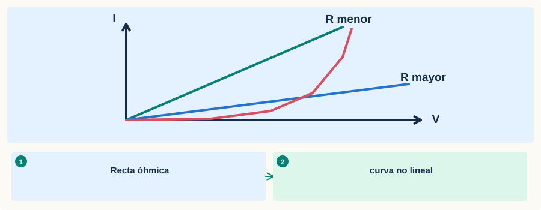

[← Anterior](04.md) · [Índice](../README.md) · [Siguiente →](06.md)

# 05 · No óhmicos: límites

*Diagrama didáctico y secuencia conceptual; no a escala.*

## ¿Qué es y por qué ocurre?

Un LED tiene una relación corriente-tensión no lineal y depende de temperatura. Una lámpara incandescente cambia de resistencia al calentarse. Se puede calcular V/I en un punto de funcionamiento, pero eso no vuelve constante la relación. El modelo ideal simplifica el comportamiento.

## Ejemplo explicado

> Si a 1 V un dispositivo conduce 1 mA y a 2 V conduce 10 mA, V/I cambia de 1 kΩ a 200 Ω.

## Ahora tú

¿El dispositivo del ejemplo es óhmico entre esos puntos?

[← Anterior](04.md) · [Índice](../README.md) · [Siguiente →](06.md)
