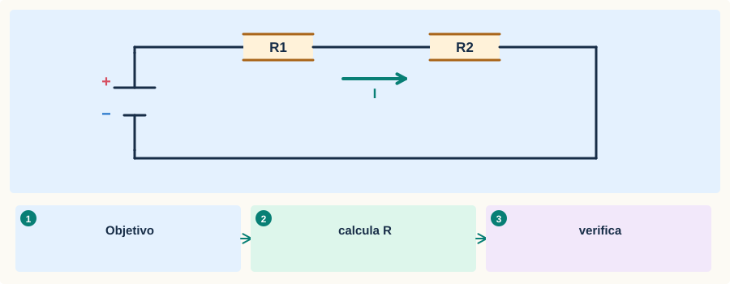

[← Anterior](05.md) · [Índice](../README.md) · [Actividades y cierre →](../descargas.md)

# 06 · Diseñar y comprobar

*Diagrama didáctico y secuencia conceptual; no a escala.*

## ¿Qué es y por qué ocurre?

Para limitar una corriente, calcula primero la resistencia y después comprueba la potencia nominal del componente (clase 008). La fuente real puede tener límites y resistencia interna. La ley de Ohm es una herramienta de predicción, no un sustituto de seguridad.

## Ejemplo explicado

> Para 5 V y una corriente objetivo de 10 mA, R=500 Ω. Un valor comercial 510 Ω da ≈9,8 mA.

## Ahora tú

A 6 V, objetivo 20 mA. ¿R ideal?

[← Anterior](05.md) · [Índice](../README.md) · [Actividades y cierre →](../descargas.md)
