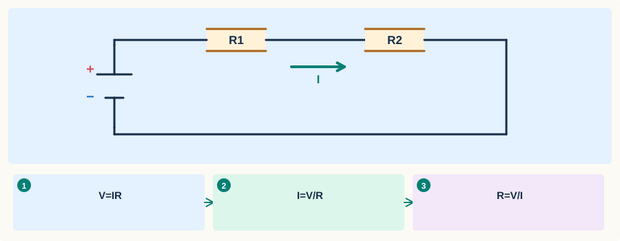

# Práctica guiada · Ley de Ohm

**Objetivo:** ¿Por qué la proporcionalidad no vale para todos los componentes?

## Procedimiento

Simula resistores de 100 y 330 Ω; registra I a 1, 2, 3 V. Dibuja dos rectas I-V con unidades; compara pendientes y predice un cuarto punto. Solo simulación hasta clase 013.

1. Formula hipótesis y dibuja el modelo antes de intervenir.
2. Identifica magnitudes que cambian y las que permanecen fijas.
3. Realiza solo el procedimiento seguro descrito; registra resultados y unidades.
4. Compara con predicción; explica diferencias, incertidumbre y limitaciones.

| Ensayo | Condiciones | Predicción | Observación o cálculo | Explicación |
|---|---|---|---|---|
| 1 | | | | |
| 2 | | | | |
| 3 | | | | |

Rúbrica: predicción 25, registro 25, explicación 40, presentación 10. Seguridad obligatoria. En simulación, los resultados calculados no son evidencia experimental independiente.

[Simulador complementario PhET](https://phet.colorado.edu/sims/html/ohms-law/latest/ohms-law_es.html) · [Plantilla de informe](../../../../../plantillas/informe-laboratorio.pdf) · [PDF](007-laboratorio.pdf) · [← Índice](../README.md)
