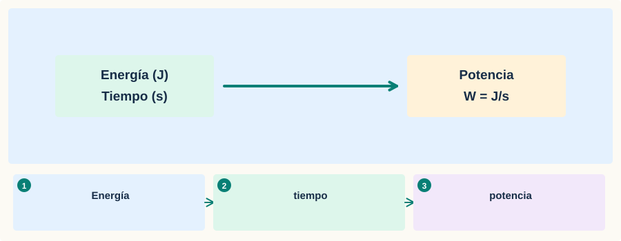
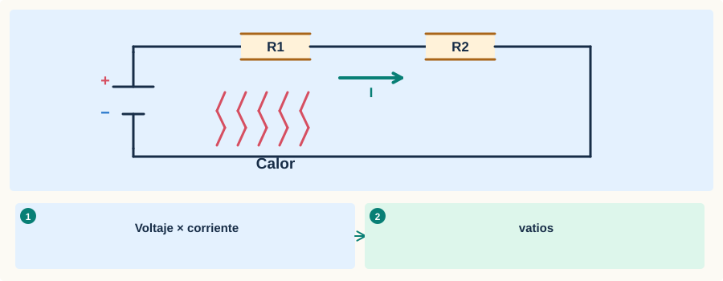
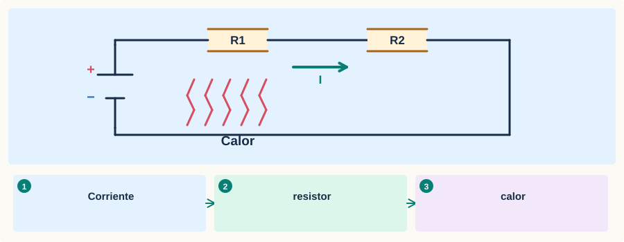
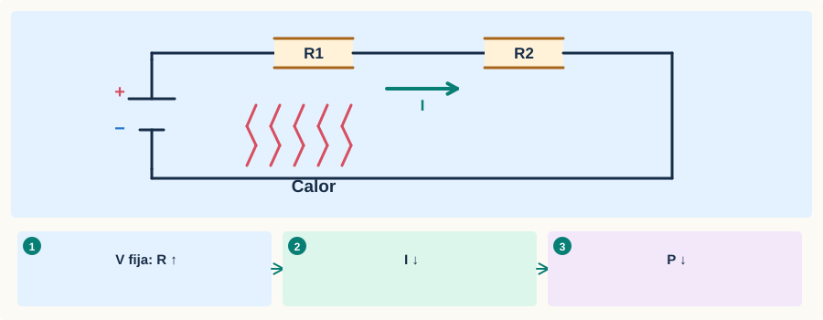
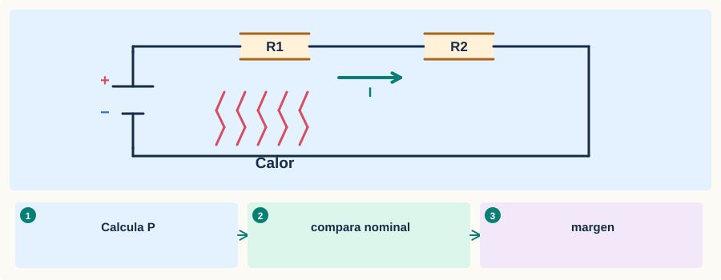
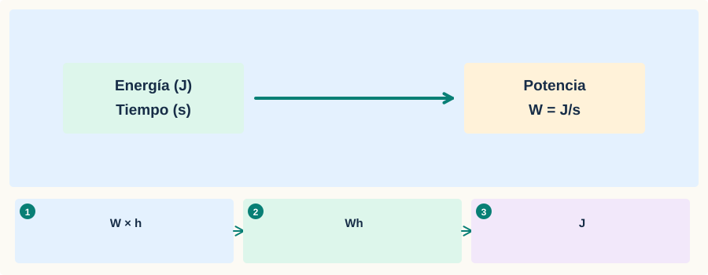

# Cuaderno de ejercicios · Clase 008

[PDF](008-ejercicios.pdf) · [← Índice](../README.md)

## 1. Potencia: rapidez de transferencia

**Ejemplo de estudio:** 60 J en 10 s: P=6 W. Los mismos 60 J en 2 s: 30 W.

**Resuelve:** 150 J en 30 s. Calcula P.

Escribe datos, procedimiento, unidades (si corresponde), dibujo y justificación. No consultes la solución antes.

## 2. Potencia eléctrica

**Ejemplo de estudio:** 5 V y 0,2 A: P=1 W; durante 60 s, E=60 J.

**Resuelve:** 12 V y 0,5 A durante 10 s: P y E.

Escribe datos, procedimiento, unidades (si corresponde), dibujo y justificación. No consultes la solución antes.

## 3. Efecto Joule

**Ejemplo de estudio:** 0,1 A en 100 Ω: P=1 W. Si I se duplica con R fija, P=4 W.

**Resuelve:** 0,02 A en 330 Ω. Calcula P.

Escribe datos, procedimiento, unidades (si corresponde), dibujo y justificación. No consultes la solución antes.

## 4. No confundir qué se mantiene fijo

**Ejemplo de estudio:** A 3 V, 220 Ω disipa 40,9 mW y 1 kΩ disipa 9 mW.

**Resuelve:** A 6 V, compara P en 100 Ω y 200 Ω.

Escribe datos, procedimiento, unidades (si corresponde), dibujo y justificación. No consultes la solución antes.

## 5. Potencia nominal y margen

**Ejemplo de estudio:** 5 V sobre 100 Ω: P=0,25 W; evitar usar un resistor de 0,25 W justo al límite; considerar 0,5 W o más según condiciones.

**Resuelve:** 3 V sobre 330 Ω: P≈? ¿Un resistor de 0,25 W tendría margen ideal?

Escribe datos, procedimiento, unidades (si corresponde), dibujo y justificación. No consultes la solución antes.

## 6. Energía y consumo en sistemas

**Ejemplo de estudio:** Una lámpara de 5 W durante 2 h consume 10 Wh=36.000 J.

**Resuelve:** Un equipo de 60 W durante 30 min consume ¿cuántos Wh?

Escribe datos, procedimiento, unidades (si corresponde), dibujo y justificación. No consultes la solución antes.
