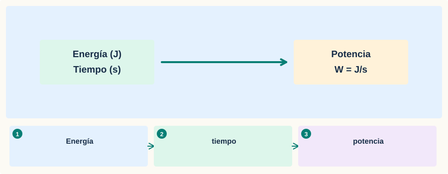
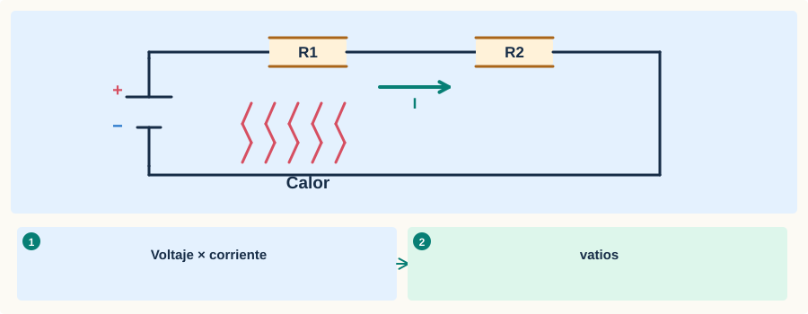
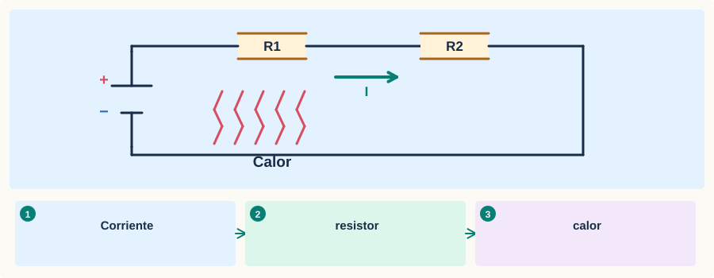
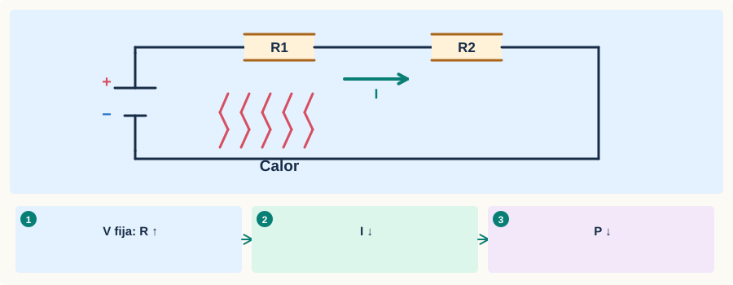
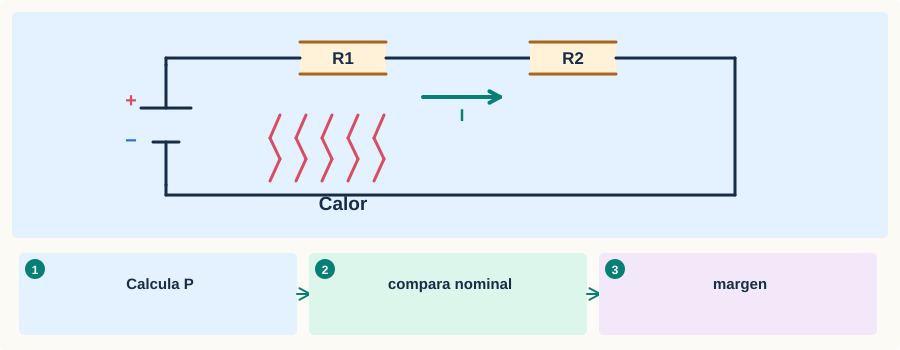
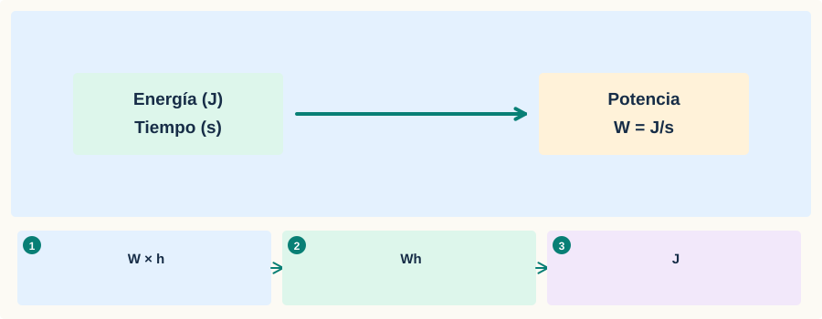

# Potencia eléctrica y efecto Joule

[← Índice](../README.md)

## 01 · Potencia: rapidez de transferencia

La potencia es energía transferida por unidad de tiempo: P=ΔE/Δt si se promedia. El vatio equivale a J/s. Dos aparatos pueden transferir la misma energía, pero uno hacerlo en menos tiempo y tener más potencia.

**Ejemplo:** 60 J en 10 s: P=6 W. Los mismos 60 J en 2 s: 30 W.

**Aplica:** 150 J en 30 s. Calcula P.

---

## 02 · Potencia eléctrica

Para un elemento DC, P=VI con convención pasiva (corriente entrando al terminal positivo: potencia absorbida). Una fuente que entrega energía tiene potencia absorbida negativa. Si P constante, E=Pt. V·A=J/s.

**Ejemplo:** 5 V y 0,2 A: P=1 W; durante 60 s, E=60 J.

**Aplica:** 12 V y 0,5 A durante 10 s: P y E.

---

## 03 · Efecto Joule

En un resistor óhmico, sustituir V=IR en P=VI da P=I²R=V²/R. La energía transferida aumenta la energía interna del material y puede salir como calor. La carga no desaparece; la fuente sostiene el campo.

**Ejemplo:** 0,1 A en 100 Ω: P=1 W. Si I se duplica con R fija, P=4 W.

**Aplica:** 0,02 A en 330 Ω. Calcula P.

---

## 04 · No confundir qué se mantiene fijo

Con corriente fija, aumentar R aumenta P=I²R. Con voltaje fijo, aumentar R reduce P=V²/R. Ambas expresiones son coherentes porque V, I y R están relacionadas. Siempre identifica qué variable controla la fuente.

**Ejemplo:** A 3 V, 220 Ω disipa 40,9 mW y 1 kΩ disipa 9 mW.

**Aplica:** A 6 V, compara P en 100 Ω y 200 Ω.

---

## 05 · Potencia nominal y margen

La potencia nominal indica cuánto puede disipar un componente bajo condiciones especificadas por fabricante; depende de temperatura, montaje y ventilación. Elegir un margen razonable no sustituye la hoja de datos. Un resistor de 0,25 W no debe operarse deliberadamente por encima de su capacidad.

**Ejemplo:** 5 V sobre 100 Ω: P=0,25 W; evitar usar un resistor de 0,25 W justo al límite; considerar 0,5 W o más según condiciones.

**Aplica:** 3 V sobre 330 Ω: P≈? ¿Un resistor de 0,25 W tendría margen ideal?

---

## 06 · Energía y consumo en sistemas

1 Wh=3600 J; 1 kWh=3,6 MJ. Un equipo de 20 W durante 3 h consume 60 Wh=216 kJ. La refrigeración retira energía térmica; no elimina la conservación. La potencia de un procesador depende de operación, tensión, frecuencia y pérdidas.

**Ejemplo:** Una lámpara de 5 W durante 2 h consume 10 Wh=36.000 J.

**Aplica:** Un equipo de 60 W durante 30 min consume ¿cuántos Wh?

---
