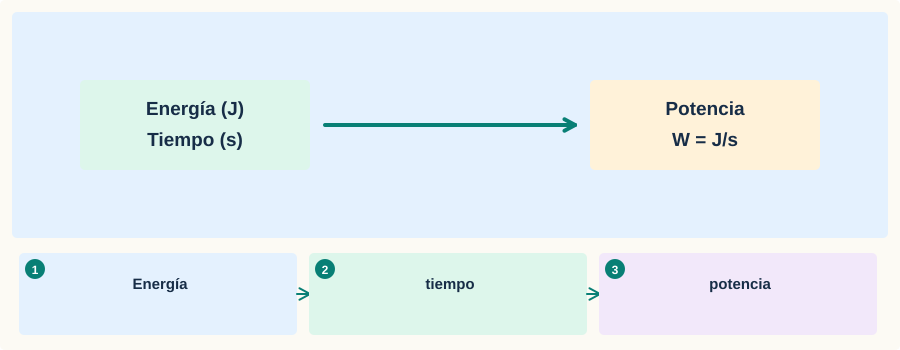

[← Portada](../README.md) · [Índice](../README.md) · [Siguiente →](02.md)

# 01 · Potencia: rapidez de transferencia

*Diagrama didáctico y secuencia conceptual; no a escala.*

## ¿Qué es y por qué ocurre?

La potencia es energía transferida por unidad de tiempo: P=ΔE/Δt si se promedia. El vatio equivale a J/s. Dos aparatos pueden transferir la misma energía, pero uno hacerlo en menos tiempo y tener más potencia.

## Ejemplo explicado

> 60 J en 10 s: P=6 W. Los mismos 60 J en 2 s: 30 W.

## Ahora tú

150 J en 30 s. Calcula P.

[← Portada](../README.md) · [Índice](../README.md) · [Siguiente →](02.md)
