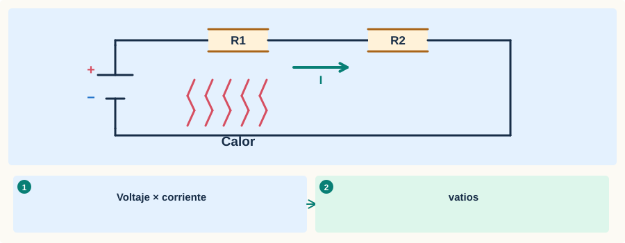
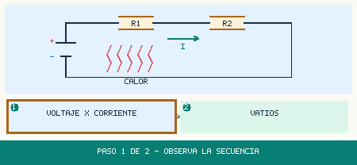

[← Anterior](01.md) · [Índice](../README.md) · [Siguiente →](03.md)

# 02 · Potencia eléctrica

*Diagrama didáctico y secuencia conceptual; no a escala.*

## ¿Qué es y por qué ocurre?

Para un elemento DC, P=VI con convención pasiva (corriente entrando al terminal positivo: potencia absorbida). Una fuente que entrega energía tiene potencia absorbida negativa. Si P constante, E=Pt. V·A=J/s.

## Ejemplo explicado

> 5 V y 0,2 A: P=1 W; durante 60 s, E=60 J.

## Ahora tú

12 V y 0,5 A durante 10 s: P y E.

## Secuencia animada

*Se resaltan etapas del diagrama, no se pretende simular el movimiento físico real.*

[← Anterior](01.md) · [Índice](../README.md) · [Siguiente →](03.md)
