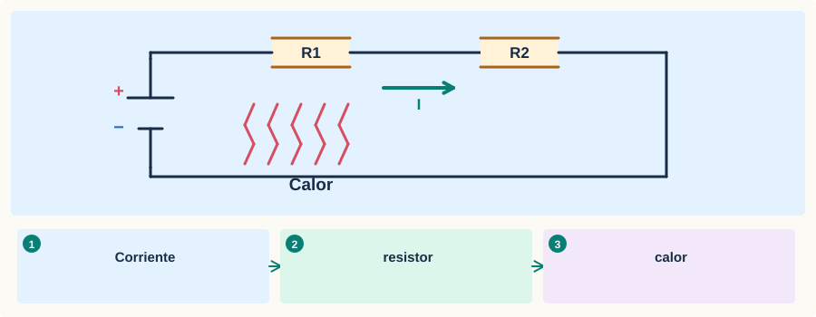

[← Anterior](02.md) · [Índice](../README.md) · [Siguiente →](04.md)

# 03 · Efecto Joule

*Diagrama didáctico y secuencia conceptual; no a escala.*

## ¿Qué es y por qué ocurre?

En un resistor óhmico, sustituir V=IR en P=VI da P=I²R=V²/R. La energía transferida aumenta la energía interna del material y puede salir como calor. La carga no desaparece; la fuente sostiene el campo.

## Ejemplo explicado

> 0,1 A en 100 Ω: P=1 W. Si I se duplica con R fija, P=4 W.

## Ahora tú

0,02 A en 330 Ω. Calcula P.

[← Anterior](02.md) · [Índice](../README.md) · [Siguiente →](04.md)
