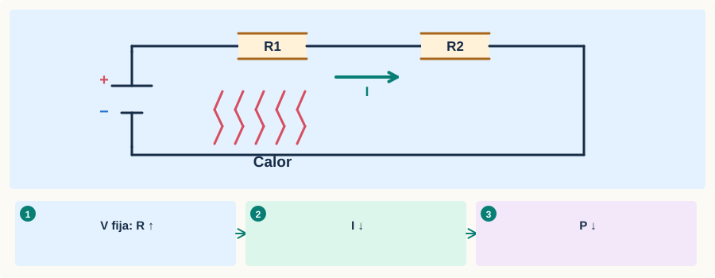

[← Anterior](03.md) · [Índice](../README.md) · [Siguiente →](05.md)

# 04 · No confundir qué se mantiene fijo

*Diagrama didáctico y secuencia conceptual; no a escala.*

## ¿Qué es y por qué ocurre?

Con corriente fija, aumentar R aumenta P=I²R. Con voltaje fijo, aumentar R reduce P=V²/R. Ambas expresiones son coherentes porque V, I y R están relacionadas. Siempre identifica qué variable controla la fuente.

## Ejemplo explicado

> A 3 V, 220 Ω disipa 40,9 mW y 1 kΩ disipa 9 mW.

## Ahora tú

A 6 V, compara P en 100 Ω y 200 Ω.

[← Anterior](03.md) · [Índice](../README.md) · [Siguiente →](05.md)
