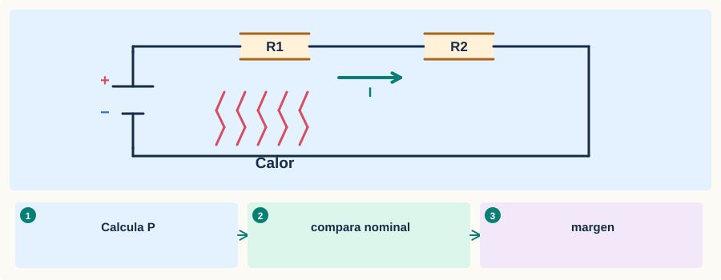

[← Anterior](04.md) · [Índice](../README.md) · [Siguiente →](06.md)

# 05 · Potencia nominal y margen

*Diagrama didáctico y secuencia conceptual; no a escala.*

## ¿Qué es y por qué ocurre?

La potencia nominal indica cuánto puede disipar un componente bajo condiciones especificadas por fabricante; depende de temperatura, montaje y ventilación. Elegir un margen razonable no sustituye la hoja de datos. Un resistor de 0,25 W no debe operarse deliberadamente por encima de su capacidad.

## Ejemplo explicado

> 5 V sobre 100 Ω: P=0,25 W; evitar usar un resistor de 0,25 W justo al límite; considerar 0,5 W o más según condiciones.

## Ahora tú

3 V sobre 330 Ω: P≈? ¿Un resistor de 0,25 W tendría margen ideal?

[← Anterior](04.md) · [Índice](../README.md) · [Siguiente →](06.md)
