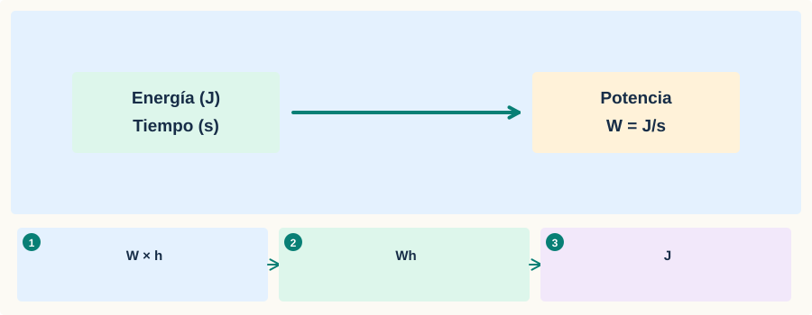

[← Anterior](05.md) · [Índice](../README.md) · [Actividades y cierre →](../descargas.md)

# 06 · Energía y consumo en sistemas

*Diagrama didáctico y secuencia conceptual; no a escala.*

## ¿Qué es y por qué ocurre?

1 Wh=3600 J; 1 kWh=3,6 MJ. Un equipo de 20 W durante 3 h consume 60 Wh=216 kJ. La refrigeración retira energía térmica; no elimina la conservación. La potencia de un procesador depende de operación, tensión, frecuencia y pérdidas.

## Ejemplo explicado

> Una lámpara de 5 W durante 2 h consume 10 Wh=36.000 J.

## Ahora tú

Un equipo de 60 W durante 30 min consume ¿cuántos Wh?

[← Anterior](05.md) · [Índice](../README.md) · [Actividades y cierre →](../descargas.md)
