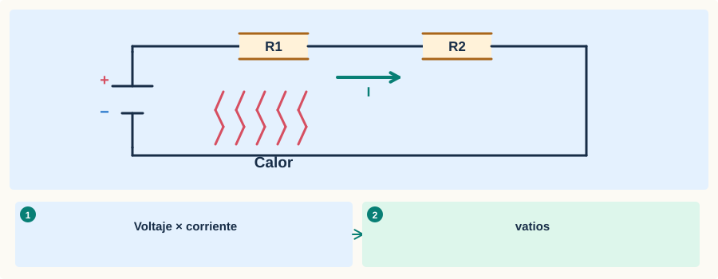

# Práctica guiada · Potencia eléctrica y efecto Joule

**Objetivo:** ¿Por qué se calienta un resistor y de dónde viene ese calor?

## Procedimiento

En simulación compara 220 Ω y 1 kΩ a 3 V; calcula I, P y energía en 60 s. Predice el cambio de P al duplicar I y luego al duplicar R con V fija. No toques resistores calientes ni realices cortos.

1. Formula hipótesis y dibuja el modelo antes de intervenir.
2. Identifica magnitudes que cambian y las que permanecen fijas.
3. Realiza solo el procedimiento seguro descrito; registra resultados y unidades.
4. Compara con predicción; explica diferencias, incertidumbre y limitaciones.

| Ensayo | Condiciones | Predicción | Observación o cálculo | Explicación |
|---|---|---|---|---|
| 1 | | | | |
| 2 | | | | |
| 3 | | | | |

Rúbrica: predicción 25, registro 25, explicación 40, presentación 10. Seguridad obligatoria. En simulación, los resultados calculados no son evidencia experimental independiente.

[Simulador complementario PhET](https://phet.colorado.edu/es/simulations/circuit-construction-kit-dc) · [Plantilla de informe](../../../../../plantillas/informe-laboratorio.pdf) · [PDF](008-laboratorio.pdf) · [← Índice](../README.md)
