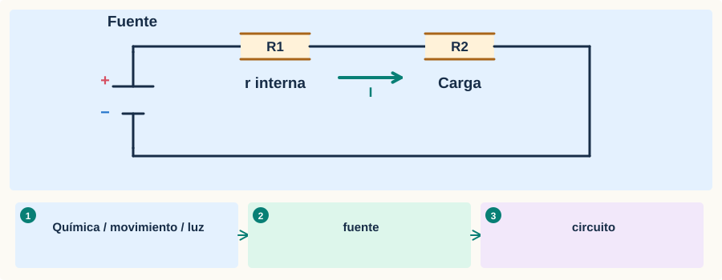
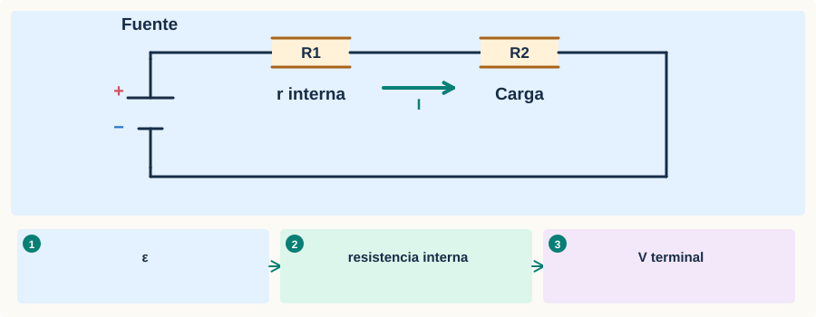
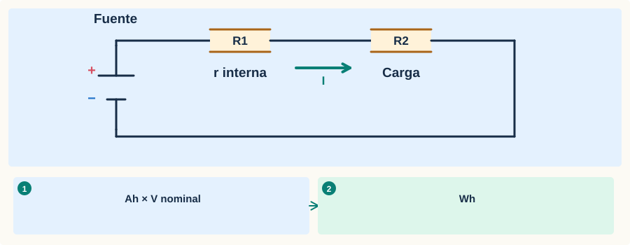
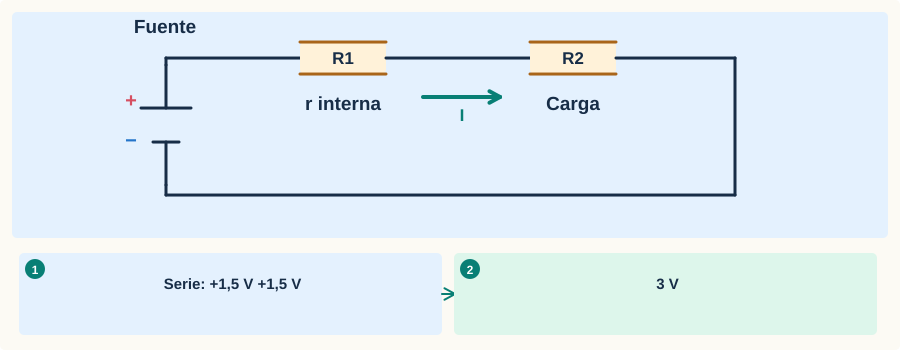
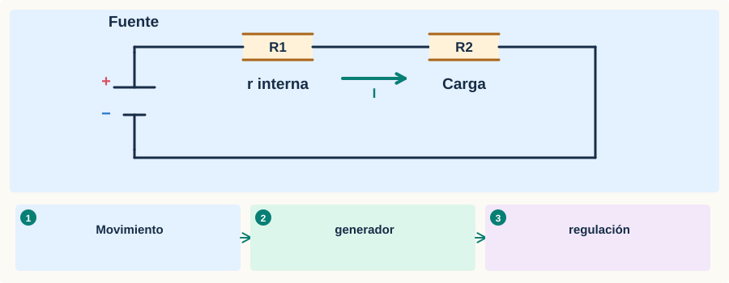
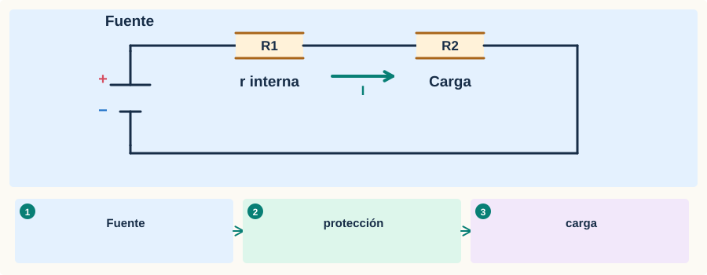

# Cuaderno de ejercicios · Clase 009

[PDF](009-ejercicios.pdf) · [← Índice](../README.md)

## 1. Qué hace una fuente

**Ejemplo de estudio:** Una fuente ideal de 5 V entrega 5 J por C que atraviesa la carga.

**Resuelve:** ¿Qué convierte una batería y qué conserva el circuito?

Escribe datos, procedimiento, unidades (si corresponde), dibujo y justificación. No consultes la solución antes.

## 2. Fuente ideal y resistencia interna

**Ejemplo de estudio:** ε=6 V, rint=1 Ω, I=0,2 A: Vterminal=5,8 V.

**Resuelve:** ε=9 V, rint=2 Ω, I=0,1 A. Calcula Vterminal.

Escribe datos, procedimiento, unidades (si corresponde), dibujo y justificación. No consultes la solución antes.

## 3. Capacidad en Ah y energía en Wh

**Ejemplo de estudio:** 3,7 V y 2 Ah: aproximadamente 7,4 Wh, equivalentes a 26,64 kJ.

**Resuelve:** Una batería de 5 Ah a 12 V nominal. ¿Wh aproximados?

Escribe datos, procedimiento, unidades (si corresponde), dibujo y justificación. No consultes la solución antes.

## 4. Conexiones de fuentes

**Ejemplo de estudio:** Dos fuentes ideales de 1,5 V en serie orientadas igual: 3 V.

**Resuelve:** Tres fuentes ideales de 1,5 V en serie: ¿voltaje?

Escribe datos, procedimiento, unidades (si corresponde), dibujo y justificación. No consultes la solución antes.

## 5. Generador y regulación

**Ejemplo de estudio:** Un adaptador 5 V 2 A indica salida nominal y límite de corriente, no que siempre entregue 2 A.

**Resuelve:** Si el equipo toma 0,4 A de 5 V, calcula P.

Escribe datos, procedimiento, unidades (si corresponde), dibujo y justificación. No consultes la solución antes.

## 6. Seguridad de fuentes

**Ejemplo de estudio:** Un modelo con ε=3 V y rint=0,1 Ω predice 30 A en corto idealizado; no es una instrucción de prueba.

**Resuelve:** ¿Por qué no debes medir corriente conectando amperímetro entre bornes?

Escribe datos, procedimiento, unidades (si corresponde), dibujo y justificación. No consultes la solución antes.
