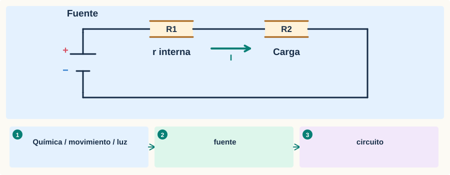
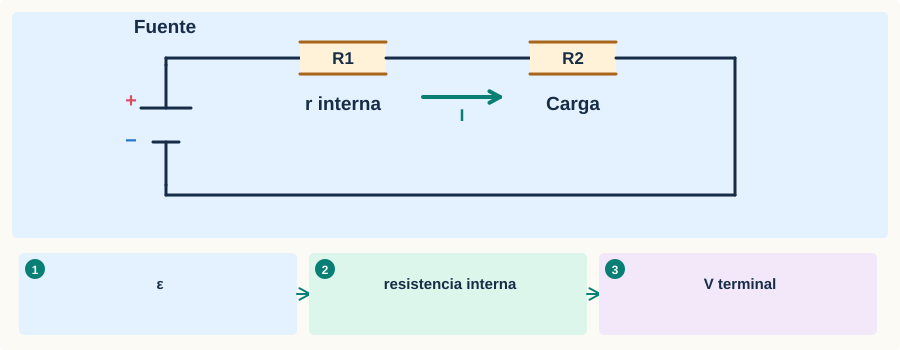
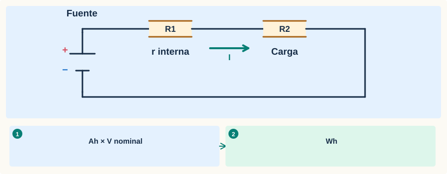
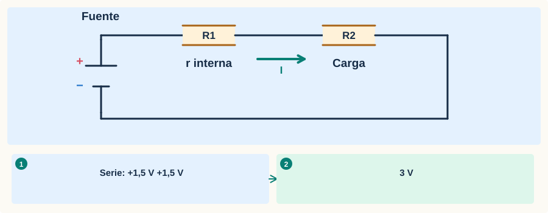
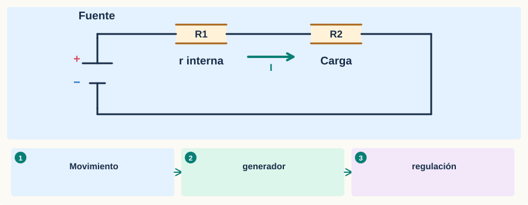
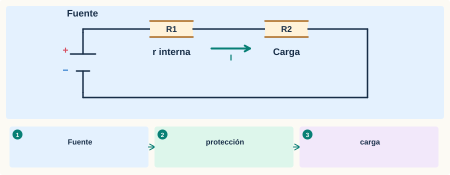

# Fuentes de energía: baterías y generadores

[← Índice](../README.md)

## 01 · Qué hace una fuente

Una fuente mantiene una diferencia de potencial mediante procesos que convierten otra forma de energía. Una pila usa reacciones químicas; un generador usa trabajo mecánico; una celda solar transforma energía radiante. No crea carga ni energía.

**Ejemplo:** Una fuente ideal de 5 V entrega 5 J por C que atraviesa la carga.

**Aplica:** ¿Qué convierte una batería y qué conserva el circuito?

---

## 02 · Fuente ideal y resistencia interna

Una fuente de tensión ideal mantiene su tensión independientemente de corriente. Una fuente real tiene pérdidas y límites. Modelo básico de descarga: Vterminal=ε−Irint. La fuerza electromotriz ε es energía por carga suministrada por la fuente, no una fuerza mecánica en N.

**Ejemplo:** ε=6 V, rint=1 Ω, I=0,2 A: Vterminal=5,8 V.

**Aplica:** ε=9 V, rint=2 Ω, I=0,1 A. Calcula Vterminal.

---

## 03 · Capacidad en Ah y energía en Wh

La capacidad nominal en Ah mide carga: 1 Ah=3600 C. Una batería de 2 Ah podría entregar idealmente 0,2 A durante 10 h, pero la capacidad real depende de tasa, temperatura, edad y corte de tensión. Energía aproximada Wh≈Vnom·Ah; no es garantía exacta.

**Ejemplo:** 3,7 V y 2 Ah: aproximadamente 7,4 Wh, equivalentes a 26,64 kJ.

**Aplica:** Una batería de 5 Ah a 12 V nominal. ¿Wh aproximados?

---

## 04 · Conexiones de fuentes

En un modelo de pilas idénticas compatibles, en serie se suman voltajes con polaridades orientadas correctamente; capacidad Ah ideal se mantiene. En paralelo, tensión igual y capacidad ideal se suma, pero conectar baterías directamente en paralelo exige compatibilidad, protección y diseño específico. No realizar estas conexiones como experimento improvisado.

**Ejemplo:** Dos fuentes ideales de 1,5 V en serie orientadas igual: 3 V.

**Aplica:** Tres fuentes ideales de 1,5 V en serie: ¿voltaje?

---

## 05 · Generador y regulación

El movimiento relativo entre imán y bobina puede cambiar flujo magnético e inducir tensión (clase 020). Un regulador mantiene una salida dentro de límites, pero necesita energía y tiene pérdidas. Un cargador no es simplemente una fuente cualquiera: debe seguir especificaciones de la batería.

**Ejemplo:** Un adaptador 5 V 2 A indica salida nominal y límite de corriente, no que siempre entregue 2 A.

**Aplica:** Si el equipo toma 0,4 A de 5 V, calcula P.

---

## 06 · Seguridad de fuentes

Una batería puede entregar corriente peligrosa en un cortocircuito aun con bajo voltaje. No unir bornes, no abrir celdas, no mezclar químicas y no cargar pilas no recargables. Para prácticas usar fuente limitada o portapilas adecuado, resistores nominales y supervisión después de clase 013.

**Ejemplo:** Un modelo con ε=3 V y rint=0,1 Ω predice 30 A en corto idealizado; no es una instrucción de prueba.

**Aplica:** ¿Por qué no debes medir corriente conectando amperímetro entre bornes?

---
